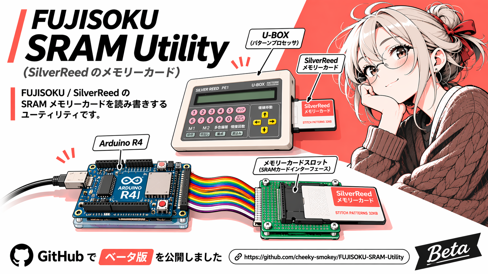
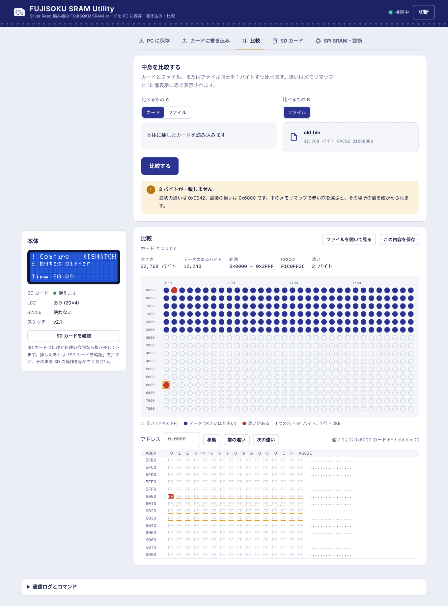
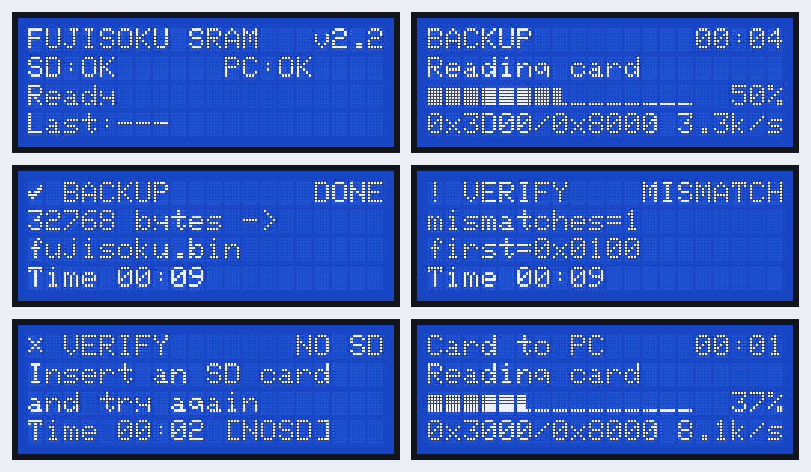
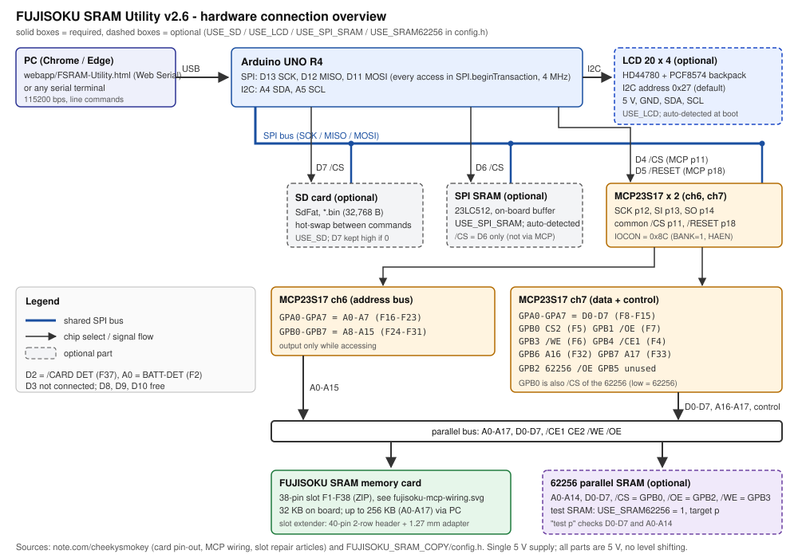

# FUJISOKU SRAM Utility

Silver Reed 編み機のメモリカード（FUJISOKU SRAM、32KB）を、Arduino UNO R4 で読み書きするツールです。MCP23S17 を 2 個使った GPIO エキスパンダでカードのアドレス・データ・制御線を直接動かし、PC・SD カード・SPI SRAM との間でコピーと照合をします。

- **PC から操作**: ブラウザの Web アプリで、カードを PC に保存・PC のファイルをカードに書き込み・比較。
- **SD カード（オプション）**: 本体だけでカード ⇄ SD のバックアップ・照合・書き戻し。SD カードは処理の合間に抜き差しでき、最初から入っていなくても止まりません。
- **表示**: 状態・処理の段階・進捗バー・結果を 20 文字 × 4 行で表示。同じ画面が Web アプリにも出るので、LCD はオプションです。
- **62256（オプション）**: 動作確認用の SRAM で、カードを使わずにバスの配線を試験できます。





## 使い方

1. 本体をスケッチ v2 で動かし、USB で PC につなぐ。
2. PC の **Google Chrome** または **Microsoft Edge** で [`webapp/FSRAM-Utility.html`](webapp/FSRAM-Utility.html) を開き、「本体に接続」を押してシリアルポートを選ぶ。
3. 目的のタブを選ぶ。

| タブ | できること |
|---|---|
| PC に保存 | カードを読み込んで `.bin` に保存（2 回読んで一致を確かめる設定あり） |
| カードに書き込み | `.bin`（32,768 バイト）をカードへ。書き込む前の自動保存、変わった部分だけの書き込み、書き込み後の照合 |
| 比較 | カードとファイル、またはファイル同士を比較。違いはメモリマップと 16 進表示に赤で出る |
| SD カード | 本体の SD カードとの保存・照合・書き込み、ファイル一覧（SD を使う設定のときだけ表示） |
| SPI SRAM・診断 | SPI SRAM とのコピー・比較・消去、SPI SRAM の自己診断。62256 を使う設定なら、62256 でのバス試験など |

Web アプリの詳しい説明は [docs/webapp.md](docs/webapp.md)、シリアルコマンドは [docs/protocol.md](docs/protocol.md) にあります。従来の 1 文字コマンド（`B` `L` `V` `R` `C` `X` `S` `W` `T` `E` `e`）もそのまま使えます。

## 必要なもの

| 区分 | 部品 | `config.h` |
|---|---|---|
| 必須 | Arduino UNO R4、MCP23S17 × 2、FUJISOKU カードのスロット | - |
| 必須 | **SPI SRAM**（23LC512 クラス、データの一時保管。/CS は D6。MCP23S17 にはつながない） | - |
| オプション | SD カードモジュール（/CS は D7） | `USE_SD`（既定 1） |
| オプション | 20 × 4 キャラクタ LCD（HD44780 + PCF8574 の I2C バックパック。5V・GND・SDA = A4・SCL = A5） | `USE_LCD`（既定 1） |
| オプション | 62256 並列 SRAM（動作確認用。カードと同じバスにつなぐ） | `USE_SRAM62256`（既定 0） |

カードの吸い出し・書き込み・比較は Web アプリでできるので、SD カードと LCD はなくても使えます。オプション部品は `FUJISOKU_SRAM_COPY/config.h` の先頭で選びます。

```c
#define USE_SD 1          // SD カードをつながないなら 0 (SdFat ライブラリも不要になる)
#define USE_LCD 1         // LCD をつながないなら 0 (LiquidCrystal I2C ライブラリも不要になる)
#define USE_SRAM62256 0   // 62256 をつないだら 1
```

`USE_LCD` が 1 のままでも、LCD が見つからなければ表示を飛ばして動きます。LCD の I2C アドレスは `LCD_I2C_ADDR`（既定 `0x27`、表示されないときは `0x3F`）です。

接続図・信号表・ピン配置は [docs/hardware.md](docs/hardware.md) を参照してください。



## ビルド

1. Arduino IDE のライブラリマネージャで、使う部品に合わせて入れる（SD と LCD を使わないなら不要）。
   - **SdFat**（Bill Greiman、v2 系）。`USE_SD` が 1 のときだけ必要です。
   - **LiquidCrystal I2C**（Frank de Brabander）。`USE_LCD` が 1 のときだけ必要です。「AVR 用」と警告が出ることがありますが、UNO R4 でも使えます。
2. `FUJISOKU_SRAM_COPY/FUJISOKU_SRAM_COPY.ino` を開いてボードに書き込む（同じフォルダの `.ino` と `config.h` はタブとして一緒に開かれます）。

v1 で使っていた Adafruit GFX / ILI9341 / XPT2046 は不要になりました。

## 構成

```
FUJISOKU_SRAM_COPY/         スケッチ (メイン、config.h、hardware / storage / operations / protocol / lcd_ui)
webapp/FSRAM-Utility.html   Web アプリ (1 ファイル、インストール不要)
docs/                       hardware.md (配線)、specification.md (ソフト仕様)、protocol.md (通信)、webapp.md
test/                       PC 上でスケッチを動かすシミュレータと自動テスト (test/README.md)
```

## 確かめたこと

スケッチをそのまま PC でビルドし、MCP23S17・カード・SPI SRAM・SD カード・LCD を再現したシミュレータで動かして、53 件の自動テスト（ファームウェア 27、表示 9、Web アプリ 17。SD・LCD・62256 のあり・なしの構成を含む）が通ることを確認しています。v2.3 の変更点は [docs/specification.md §12](docs/specification.md#12-v23-の変更コードレビューの結果) にあります。本物の SdFat と LiquidCrystal I2C のヘッダに対する型チェックも通っています。**実機での動作確認はまだです。** 詳しくは [test/README.md](test/README.md) を参照してください。
