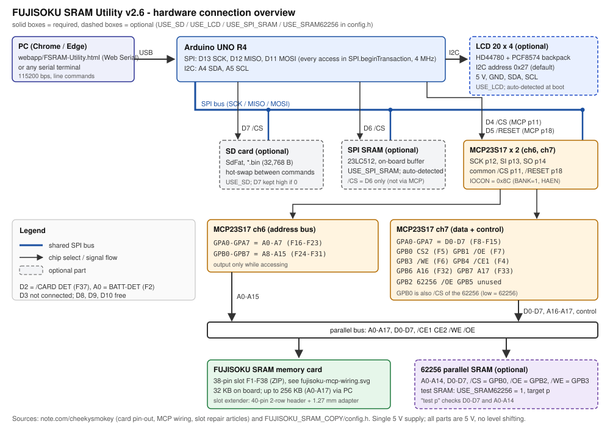
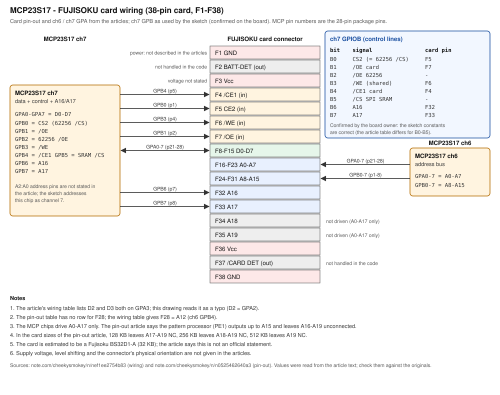

# ハードウェア仕様 / 接続

この資料は次の出典とスケッチを突き合わせてまとめています。

| 区分 | 出典 |
|---|---|
| MCP23S17 とカードの結線 | note「cheekysmokey」配線の記事 <https://note.com/cheekysmokey/n/nef1ee2754b83>（2026-04-09） |
| FUJISOKU カードのピン配置 | 同ピン配置の記事 <https://note.com/cheekysmokey/n/n0525462640a3>（2026-01-31） |
| スロット（修理とエクステンダー化） | 同スロットの記事 <https://note.com/cheekysmokey/n/nd67f79d83b57> |
| Arduino ピン、制御定数、アクセス手順 | `FUJISOKU_SRAM_COPY/config.h`、`hardware.ino` |

> **注意**
> - 記事の値は本文テキストから読み取ったものです。結線は原文の表と照合してください。
> - **ch7 ポート B（制御線）はスケッチの割り当てが正しい**ことを、基板の作者に確認済みです（§7）。配線の記事の表とは B0〜B4 が違います。
> - 基板の回路図ではありません。記事に書かれていない項目は「要確認」にしています（§13）。

## 1. 部品の構成

| 区分 | 部品 | 用途 | スケッチの設定（`config.h`） |
|---|---|---|---|
| 必須 | Arduino UNO R4 | 制御、PC との USB シリアル | - |
| 必須 | MCP23S17 × 2 | カードのアドレス（ch6）とデータ・制御線（ch7） | - |
| 必須 | FUJISOKU カードのスロット | カードの接続（§12） | - |
| 必須 | SPI SRAM（23LC512 クラス、/CS = D6） | **データの一時保管**（カード ⇄ SPI SRAM のコピー・比較） | - |
| オプション | SD カードモジュール | 本体だけでの `*.bin` の保存・照合・書き戻し | `USE_SD`（既定 1） |
| オプション | 20×4 キャラクタ LCD（I2C） | 本体での状態・進捗の表示。同じ内容は Web アプリにも出る | `USE_LCD`（既定 1） |
| オプション | 62256 並列 SRAM | **動作確認用**。カードを使わずにバスと配線を試す | `USE_SRAM62256`（既定 0） |

カードの吸い出し・書き込み・比較は Web アプリ（PC）でできるので、**必須なのは Arduino UNO R4、MCP23S17 × 2、スロット、SPI SRAM だけ**です。SD と LCD を 0 にすれば、外部ライブラリも要りません。

- `USE_SD` を 0 にすると SD のコードが入らず、SdFat ライブラリも要りません。SD のコマンドは `ERR DISABLED` を返します（§10）。
- `USE_LCD` が 1 でも、起動時に LCD が I2C に応答しなければ LCD には何も送らずに動きます。LCD をつながないなら 0 にすると、LiquidCrystal I2C ライブラリも要りません。
- `USE_SRAM62256` を 1 にすると、コマンドの対象 `p` として 62256 を使えます（§9.2）。0 のときは 62256 のコードは入りません。62256 をつながなくても、制御線 B0（CS2）と B2 の動きは変わりません。

## 2. 全体接続図

- Arduino UNO R4 が SPI マスタです。PC とは USB シリアル（115200 bps）でつながり、Web アプリ（`webapp/FSRAM-Utility.html`）やシリアル端末から操作します。
- カードのアドレス・データ・制御線は **MCP23S17 を 2 個**（ch6 = アドレス、ch7 = データ + 制御）使った GPIO エキスパンダ経由で駆動します。
- 破線の箱（SD カード、LCD、62256）はオプション部品です。v1 の TFT（ILI9341）とタッチ（XPT2046）は使いません。

## 3. Arduino ピン割り当て

| ピン | 定義名 | 接続先 | 備考 |
|---|---|---|---|
| D13 / D12 / D11 | - | SCK / MISO / MOSI（MCP23S17・SPI SRAM・SD で共用） | アクセスごとに `SPI.beginTransaction()`（4 MHz、モード 0） |
| A4 / A5 | - | LCD の SDA / SCL（PCF8574 バックパック、オプション） | `Wire`、I2C アドレス `LCD_I2C_ADDR`（既定 `0x27`） |
| D7 | `PIN_CS_SD` | SD カード /CS（オプション） | SD を使う処理のたびにマウントし直す（§10）。`USE_SD` が 0 でも High にしておく（SD モジュールを付けたままでも SPI を邪魔しない） |
| D6 | `PIN_CS_SPI_SRAM` | **SPI SRAM /CS** | SPI SRAM の /CS はここだけ（§9.1） |
| D5 | `PIN_MCP_RESET` | MCP23S17 /RESET（p18、2 個共通） | 起動時に 1 ms Low |
| D4 | `PIN_CS_MCP` | MCP23S17 /CS（p11、2 個共通） | 2 個はハードウェアアドレス（6 と 7）で区別する |
| D3 | `PIN_MCP_INT` | MCP23S17 INT（想定） | 入力にするだけ。割り込みは使わない |
| D2、D8、D9、D10 | - | 空き | v1 では TFT とタッチに使っていた |

v2.2 まで定義だけあった D1（`CS_FSRAM_512`、未使用）は削除しました。

**SPI の設定について**: SdFat は SPI を高速なクロックに設定したまま戻しません（UNO R4 の `endTransaction()` は何もしない）。設定なしの `SPI.transfer()` だと、直前に SD を使ったときのクロックで MCP23S17（上限 10 MHz）に送ってしまうため、すべての MCP23S17 / SPI SRAM へのアクセスを `SPI.beginTransaction(4 MHz)` で囲んでいます。

## 4. MCP23S17 × 2

### 4.1 結線（記事より）

| MCP23S17 のピン | 接続 |
|---|---|
| p12 SCK / p13 SI / p14 SO | SPI の SCK / MOSI / MISO |
| p11 /CS | D4 |
| p18 /RESET | D5 |
| GPA0〜GPA7 | p21〜p28 |
| GPB0〜GPB7 | p1〜p8 |

- チップは **ch6（アドレス）と ch7（データ + 制御）** の 2 個です。
- スケッチは ch0〜ch7 の 8 チャネルすべてを初期化しますが、使うのは ch6 と ch7 だけです。存在しないチャネルへの書き込みは無視されます。
- A2:A0 ピンの設定は記事に記載がありません。スケッチは「チャネル番号 = ハードウェアアドレス」を前提にしています（要確認）。

### 4.2 オペコード

`0 1 0 0 A2 A1 A0 R/W`。チャネル（= ハードウェアアドレス）ごとに `config.h` のマクロで作ります。

| 項目 | 定義名 | 値 |
|---|---|---|
| 書き込み | `MCP_OP_WRITE(ch)` | `0x40 + ch × 2`（ch6 = `0x4C`、ch7 = `0x4E`） |
| 読み出し | `MCP_OP_READ(ch)` | `0x41 + ch × 2`（ch6 = `0x4D`、ch7 = `0x4F`） |

### 4.3 初期化（`mcp_init()`）

1. D5 を 1 ms Low にしてリセット（`setup()`）。
2. IOCON（BANK=0 のアドレス `0x0A`）へ `0x8C`（`MCP_IOCON_VALUE` = BANK + HAEN + ODR）を、オペコード `MCP_OP_WRITE(0)` = `0x40` と `MCP_OP_WRITE(4)` = `0x48` で 2 回書く。以後は **BANK=1** のレジスタ配置を使う。
   - HAEN が無効なあいだ、A2 ピンが High のチップは、オペコードの A2 ビットも 1 でないと応答しません（MCP23S17 の癖）。ch6 / ch7 は A2 = 1 なので `0x48` が要ります。
3. ch0〜ch7 すべてで OLAT_A/B = `0x00`、IODIR_A/B = 入力、GPPU_A/B = 全ビットプルアップ。
4. `bus_idle()`: ch7 IODIR_A = 入力、ch6 IODIR_A/B = 入力、**ch7 GPIO_B = `0x3F`（全制御線 非選択）を書いてから** ch7 IODIR_B = 出力。
   - v1 は IODIR_B を先に出力にしていたため、全制御線が一瞬 Low になっていました。v2 は値を先に書くので、この瞬間はありません。

`bus_idle()` は、すべての処理の終わり（成功・失敗・中断とも）と、PC からの `rd` `wr` `fill` の後にも呼ばれます。待機中のアドレス・データ線は入力（プルアップ）で、制御線はすべて非選択です。

### 4.4 レジスタ（BANK=1）

| レジスタ | 定義名 | アドレス |
|---|---|---|
| IODIR A / B（1 = 入力） | `MCP_IODIR_A` / `MCP_IODIR_B` | `0x00` / `0x10` |
| GPPU A / B | `MCP_GPPU_A` / `MCP_GPPU_B` | `0x06` / `0x16` |
| GPIO A / B | `MCP_GPIO_A` / `MCP_GPIO_B` | `0x09` / `0x19` |
| OLAT A / B | `MCP_OLAT_A` / `MCP_OLAT_B` | `0x0A` / `0x1A` |
| IOCON（リセット直後、BANK=0） | `MCP_IOCON_BANK0` | `0x0A` |

### 4.5 チャネルの役割

| ch | 役割 | ポート A | ポート B |
|---|---|---|---|
| 0〜5 | 初期化のみ（入力 + プルアップ） | - | - |
| 6 (`MCP_CH_ADDR`) | アドレスバス | A0〜A7 | A8〜A15 |
| 7 (`MCP_CH_DATA` / `MCP_CH_CTRL`) | データ + 制御 | D0〜D7（読むときは入力、書くときは出力） | 制御線 + A16/A17（常に出力、§7） |

## 5. FUJISOKU カードのピン配置（記事より）

38 ピン（F1〜F38）。方向はカードから見た向きです。

| ピン | 信号 | 方向 |
|---|---|---|
| F1 | GND | - |
| F2 | BATT-DET | 出力 |
| F3 | Vcc | - |
| F4 | /CE1 | 入力 |
| F5 | CE2 | 入力 |
| F6 | /WE | 入力 |
| F7 | /OE | 入力 |
| F8〜F15 | D0〜D7 | 双方向 |
| F16〜F23 | A0〜A7 | 入力 |
| F24〜F31 | A8〜A15 | 入力 |
| F32 | A16 | 入力 |
| F33 | A17 | 入力 |
| F34 | A18 | 入力 |
| F35 | A19 | 入力 |
| F36 | Vcc | - |
| F37 | /CARD DET | 出力 |
| F38 | GND | - |

- 記事のピン配置表には F28 の行がありません。結線の記事では F28 = A12 です。
- カード容量ごとの未接続ピン（記事）: 128 KB は A17〜A19、256 KB は A18〜A19、512 KB は A19 が NC。
- このカードはシルバー編機のパターンプロセッサ（PE1）が使い、PE1 は A15 までを出力して A16〜A19 は接続しない、と記事にあります。
- カード型番は Fujisoku BS32D1-A（32 KB）と推定されています（記事は公式情報ではないと明記）。
- スケッチが読み書きする範囲は **0x0000〜0x7FFF（32 KB）** です。

## 6. MCP23S17 とカードの結線

| 信号 | カードのピン | MCP | ポート | MCP のピン | 方向（MCP 側） |
|---|---|---|---|---|---|
| `D0`〜`D7` | F8〜F15 | ch7 | GPA0〜GPA7 | 21〜28 | 双方向 |
| `A0`〜`A7` | F16〜F23 | ch6 | GPA0〜GPA7 | 21〜28 | 出力 |
| `A8`〜`A15` | F24〜F31 | ch6 | GPB0〜GPB7 | 1〜8 | 出力 |
| `CE2` | F5 | ch7 | GPB0 | 1 | 出力 |
| `/OE` | F7 | ch7 | GPB1 | 2 | 出力 |
| `/WE` | F6 | ch7 | GPB3 | 4 | 出力 |
| `/CE1` | F4 | ch7 | GPB4 | 5 | 出力 |
| `A16` | F32 | ch7 | GPB6 | 7 | 出力 |
| `A17` | F33 | ch7 | GPB7 | 8 | 出力 |

- 制御線（CE2、/OE、/WE、/CE1）は **スケッチの割り当て**です（§7）。アドレス・データ・A16・A17 は記事と同じです。
- 記事の配線表では D2 と D3 がどちらも GPA3 に見えます。誤記と読み、D2 = GPA2 としています。
- A18・A19・BATT-DET・/CARD DET は MCP に接続されず、スケッチも扱いません。
- 電源（F3、F36、F1、F38）の接続、電圧、レベル変換は記事に記載がありません。

## 7. ch7 ポート B（制御線）

基板の作者に確認した、スケッチの割り当てが正しい配線です。

| ビット | 信号 | 接続先 |
|---|---|---|
| B0 | CS2（カード）／ nCS（62256） | F5。62256（オプション）の /CS と共用（High = カード側、Low = 62256 側） |
| B1 | nOE（カード） | F7 |
| B2 | nOE（62256） | 62256（オプション）の /OE。62256 が無ければ未接続でよい |
| B3 | nWE | F6。62256 の /WE と共用 |
| B4 | nCS1（カード） | F4 |
| B5 | （未使用） | どこにもつながない。出力のまま High にしておく |
| B6 | A16 | F32 |
| B7 | A17 | F33 |

配線の記事の表（B0 = /CE1、B1 = CE2、B2 = /WE、B3 = /OE、B4/B5 = NC）とは B0〜B4 が違います。v2 の途中で記事の割り当てに切り替えるオプションを試作しましたが、この確認を受けて削除しました。

SPI SRAM の /CS は Arduino の D6 につなぎ、B5 にはつなぎません（v2.2 までは B5 経由の /CS も試す自己診断がありましたが、v2.3 で削除しました）。

### 7.1 制御定数（`config.h`）

各ビットに名前を付け、状態ごとの値はそこから組み立てています。値は v1 で実機確認したものと同じで、`hardware.ino` の `static_assert` で変わっていないことを確かめています。

| ビット | 定義名 | 値 |
|---|---|---|
| B0 | `CTRL_CS2` | `0x01` |
| B1 | `CTRL_CARD_nOE` | `0x02` |
| B2 | `CTRL_62256_nOE` | `0x04` |
| B3 | `CTRL_nWE` | `0x08` |
| B4 | `CTRL_CARD_nCE1` | `0x10` |
| B5 | `CTRL_B5_UNUSED` | `0x20`（未使用。常に 1） |
| B6 / B7 | `CTRL_A16` / `CTRL_A17` | `0x40` / `0x80` |

| 状態 | 定義名 | 値 | 内容 |
|---|---|---|---|
| 待機 | `CTRL_IDLE` | `0x3F` | カードは /CE1 = H、62256 は /CS = H で、どちらも非選択 |
| カード選択 | `CTRL_CARD_SELECT` | `0x2F` | /CE1 = L、CS2 = H |
| カード解放 | `CTRL_CARD_RELEASE` | `0x3E` | /CE1 = H、CS2 = L（1 バイトごとの後始末） |
| 62256 選択 | `CTRL_62256_SELECT` | `0x3E` | /CS（B0）= L |
| 62256 解放 | `CTRL_62256_RELEASE` | `0x3F` | 待機と同じ |

- 読み出しは選択値から `/OE` のビット（カード = B1、62256 = B2）を、書き込みは `CTRL_nWE`（B3）を落として作ります（例: カードの読み出し `0x2F & ~0x02` = `0x2D`、書き込み `0x2F & ~0x08` = `0x27`）。
- カード解放（`0x3E`）は B0 を兼ねているので 62256 が選ばれた状態になりますが、/OE も /WE も High なので 62256 はバスに出てきません（v1 と同じ値）。
- A16/A17 は `bus_select()` が `(address >> 10) & 0xC0` で B6/B7 に重ねて出力します（0x0000〜0x7FFF では常に 0）。

## 8. アクセスシーケンス

PC 上のシミュレータ（`test/sim`、`FSU_SIM_TRACE=1`）で記録した、`rd f 0x1234 2` と `wr f 0x1234 5A6B` の MCP23S17 へのアクセスです。**実機の測定ではありません。** どのアクセスも `SPI.beginTransaction()` で囲みます。

v2.3 では、1 バイトごとの手順（選択 → /OE や /WE のパルス → 解放）は v1 と同じ順のまま、次の 2 点で SPI の転送を減らしました（カード全域の読み込みは、シミュレータの時間で約 10.4 秒 → 約 7.3 秒）。

- バスの向き（IODIR）は、向きが変わるときだけ書く（`bus_set_dir()`。`bus_idle()` で待機に戻る）。
- 直前に自分で書いた制御値を OLAT_B から読み戻していたのをやめ、値を覚えておく。

### 8.1 読み出し（1 バイト 7 回。最初のバイトだけ向きの設定 3 回が先に入る）

| # | ch | レジスタ | 値 | 内容 |
|---|---|---|---|---|
| (1) | 6 | IODIR_A | `0x00` | A0〜A7 を出力（最初だけ） |
| (2) | 6 | IODIR_B | `0x00` | A8〜A15 を出力（最初だけ） |
| (3) | 7 | IODIR_A | `0xFF` | D0〜D7 を入力（最初だけ） |
| 1 | 6 | GPIO_A | `0x34` | A0〜A7 |
| 2 | 6 | GPIO_B | `0x12` | A8〜A15 |
| 3 | 7 | GPIO_B | `0x2F` | カード選択（+ A16/A17） |
| 4 | 7 | GPIO_B | `0x2D` | /OE = L（B1） |
| 5 | 7 | GPIO_A 読み | データ | データバスを読む |
| 6 | 7 | GPIO_B | `0x2F` | /OE = H |
| 7 | 7 | GPIO_B | `0x3E` | カード解放 |

### 8.2 書き込み（1 バイト 7 回。最初のバイトだけ向きの設定 3 回が入る）

| # | ch | レジスタ | 値 | 内容 |
|---|---|---|---|---|
| 1 | 7 | GPIO_A | `0x5A` | データを出力ラッチへ（**先に**値を決めてから出力にする） |
| (2) | 6 | IODIR_A / IODIR_B | `0x00` | アドレスを出力（最初だけ） |
| (3) | 7 | IODIR_A | `0x00` | D0〜D7 を出力（最初だけ） |
| 2 | 6 | GPIO_A | `0x34` | A0〜A7 |
| 3 | 6 | GPIO_B | `0x12` | A8〜A15 |
| 4 | 7 | GPIO_B | `0x2F` | カード選択 |
| 5 | 7 | GPIO_B | `0x27` | /WE = L（B3） |
| 6 | 7 | GPIO_B | `0x2F` | /WE = H（この立ち上がりで書き込まれる） |
| 7 | 7 | GPIO_B | `0x3E` | カード解放 |

処理の最後に `bus_idle()` が IODIR を入力に戻し、制御線を `0x3F` にします。

v2.2 までは「/WE = L → データを出す → /WE = H」の順で、/WE が Low のあいだに前のバイトの値が一瞬カードに書かれていました（最後に正しい値で上書きされるので結果は同じ）。v2.3 はデータを先に出すので、この途中の値はありません。

シミュレータでは、カードの SRAM は /WE の立ち上がりでデータを取り込むモデルにしてあり、「書き込み中にアドレスやデータが変わる」「/OE と /WE が同時に Low」「データバスの衝突」がないことをテストで確かめています。

## 9. SPI SRAM（必須）と 62256（オプション）

### 9.1 SPI SRAM（必須、データの一時保管）

| 項目 | 値 |
|---|---|
| 想定デバイス | 23LC512 クラス（64 KB。正確な型番は要確認） |
| /CS | **Arduino D6**（`PIN_CS_SPI_SRAM`）。MCP23S17 にはつながない |
| SCK / MOSI / MISO | D13 / D11 / D12（MCP23S17・SD と共用） |
| アドレス | 16 ビット（2 バイト） |
| READ / WRITE | `0x03` / `0x02`（`SRAM23_READ` / `SRAM23_WRITE`） |
| モードレジスタ READ / WRITE | `0x05` / `0x01`（`SRAM23_RDMR` / `SRAM23_WRMR`） |
| モード | バイト `0x00`、ページ `0x80`、シーケンシャル `0x40`（電源投入時） |
| 利用範囲 | 0x0000〜0x7FFF（32 KB） |
| 関数 | `read_spi_sram_byte()` / `write_spi_sram_byte()`、`spi_sram_read_mode()`、`spi_sram_init()` |
| コマンドの対象 | `s` |

- 起動時に `spi_sram_init()` でモードをシーケンシャル（`0x40`、電源投入時と同じ）に揃えます。Arduino だけリセットしたときに、前の設定が残らないようにするためです。読み書きは 1 バイトごとに /CS を上げ下げするので、どのモードでも同じように動きます。
- 配線の確認は自己診断（Web アプリの「SPI SRAM・診断」、または `test`）でできます。モードレジスタが `40` なら応答あり、`FF` なら応答なし（/CS・MISO・電源を確認）です。`status` の `spi=` にも同じ値が出ます。
- v2.2 までの `config.h` は `MODE_RW_PAGE` と `MODE_RW_SEQ` の値が逆でした（データシートではページ `0x80`、シーケンシャル `0x40`）。v2.3 で直しました。

### 9.2 62256 並列 SRAM（オプション、動作確認用）

`config.h` の `USE_SRAM62256` を 1 にしたときだけ使います。

| 項目 | 内容 |
|---|---|
| 接続 | アドレス A0〜A14・データ D0〜D7・/WE（B3）をカードと共用。/CS = B0（Low で選択、カードの CS2 と共用）、/OE = B2 |
| 関数 | `read_sram62256()` / `write_sram62256()`（`USE_SRAM62256` が 0 ならコンパイルされない） |
| コマンドの対象 | `p`（`rd` `wr` `fill` `copy` `cmp` `erase` `sd save/load/verify`） |
| バス試験 | `test p`: データ線 D0〜D7（1 ビットずつの値などを書いて読み戻す）と、アドレス線 A0〜A14（0x0000 と 2^n の 16 か所で、ほかの場所の値が変わらないか）を調べ、H / L 固定やショートの疑いがある線を返す。A_n が H か L に固定されていると 0 番地と 2^n 番地が同じ場所になるので、どちらに書いても他方が変わる。62256 の中身は消える |

カードを挿す前に `test p` でバスと MCP23S17 の配線を確かめ、`copy f p` → `cmp f p` でカードの読み出しを確かめる、という使い方を想定しています。

v1 の `SPI_SRAM` マクロ（SPI SRAM の代わりに 62256 を使う）は廃止しました。SPI SRAM は常に必須です。

## 10. SD カード（オプション）

| 項目 | 内容 |
|---|---|
| 設定 | `USE_SD`（既定 1） |
| ライブラリ | SdFat（Bill Greiman、v2 系）。`USE_SD` が 0 なら不要 |
| 接続 | SPI（D13 / D12 / D11）、/CS = D7 |
| 用途 | PC を使わずに、カード ⇄ SD の保存・照合・書き戻し（Web アプリの「SD カード」タブ、または `sd` コマンド・`B` `L` `V`） |

`USE_SD` が 0 のときは、SD のコード（`storage.ino` と SD の処理）がコンパイルされません。`sd` `sdcheck` と 1 文字コマンドの `B` `L` `V` `S` `W` は `ERR DISABLED` を返し、LCD の待機画面は `SD:off`、Web アプリは SD のタブを隠します。

`USE_SD` が 1 のとき:

- SdFat（v2）を使い、ルートの `*.bin`（32,768 バイト）を扱います。既定のファイル名は `fujisoku.bin`。
- SD を使う処理を始めるたびにマウントし直すので、**処理の合間なら抜き差しできます**。起動時に SD が無くても止まりません。
- 待機中は 1.5 秒ごとにカードの応答を確かめ、抜かれたら LCD と PC に知らせます（`E SD 0`）。カードが無いときの `SD.begin()` は約 2 秒かかるため、挿したことの自動検出はしません。次の SD 処理か「SD カードを確認」（`sdcheck`）で認識します。
- UNO R4 の SdFat は `SD.end()` で共有の SPI ごと止めるので、スケッチは直後に SPI を動かし直します（MCP23S17 と SPI SRAM が使えなくなるのを防ぐ）。
- バックアップは一時ファイル `FSU_TMP.TMP` に書いてから名前を付け替えます。途中で失敗・中断・SD が抜けても、前のバックアップは残ります。

## 11. LCD（オプション、20 文字 × 4 行、I2C）

| 項目 | 値 |
|---|---|
| モジュール | HD44780 互換の 20×4 キャラクタ LCD + PCF8574 I2C バックパック |
| 接続 | 5V、GND、SDA = A4、SCL = A5 |
| I2C アドレス | `LCD_I2C_ADDR`（既定 `0x27`。基板によっては `0x3F`） |
| ライブラリ | LiquidCrystal I2C（Frank de Brabander）。`USE_LCD` が 0 なら不要 |
| 設定 | `USE_LCD`（既定 1）、`LCD_I2C_ADDR` |

- 起動時に `LCD_I2C_ADDR` へ I2C で呼びかけ、応答がなければ LCD は無いものとして、以後 LCD には何も送りません（UNO R4 の Wire は応答がなくても最大 0.1 秒で戻るので、起動は止まりません）。
- LCD の有無にかかわらず、本体は 20×4 の表示内容を持ち続けます。Web アプリは `lcd on` でその内容を受け取り、同じ画面を描きます。

表示内容は [specification.md §8](specification.md#8-表示lcd-と-web-アプリ) を参照してください。バックパックの半固定抵抗でコントラストを調整しないと文字が見えないことがあります。

## 12. スロット（記事より）

スロットの記事は、パターンプロセッサ（PE1）の壊れたスロットを修理し、リボンケーブルでつなぐ「エクステンダー」にした内容です。

- フジソク製のメモリスロットは 38 ピンで、もとのピン配列は ZIP。
- 使った部品: 汎用リボンケーブル用の 40 ピン 2 列ヘッダー（ピンを曲げて取り付け、不要なピンはカット）、ハーフピッチの 38 ピンヘッダー（壊れたスロットから抜いて修復・再組立）、秋月の 10 ピン 2.54 mm ピッチ（2×5）⇔ 1.27 mm ピッチ（1×10）変換基板、ケース用のユニバーサル基板。
- 1 番ピンの位置: 変換基板の表裏で、2 列ヘッダーの 1 番ピンが上段か下段かが決まる。PE1 の ZIP 配列に 2 列ヘッダーを付けると 1 番ピンは下段になる。記事は、変換基板の表裏を通常と逆にして下段を 1 番ピンにする方法を勧めています。
- ケーブルを延長しても、信号の遅れやノイズは問題にならなかったとあります。
- カードが壊れた場合は、リボンケーブル用ヘッダーに 62256 などの市販 SRAM を付けて代用できる、ただしアドレスデコードとバッテリーバックアップの回路が別に要る、とあります。

記事にはスロットから MCP23S17 への配線先は書かれていません。本ツールの結線は §6 です。

## 13. 要確認事項

### 13.1 確定したもの

| 項目 | 結果 |
|---|---|
| 使用ボード | Arduino UNO R4 |
| MCP23S17 の数 | 2 個（ch6、ch7） |
| D5 / D4 | MCP23S17 の /RESET（p18）/ /CS（p11） |
| カードのピン配置 | §5 |
| **ch7 ポート B の制御線** | **スケッチの割り当て**（§7、基板の作者に確認） |
| 部品の区分 | SPI SRAM は必須（一時保管）。SD カード、LCD、62256 はオプション（§1） |
| SPI SRAM の /CS | Arduino D6。MCP23S17 ch7 B5 にはつながない（B5 は未使用） |
| 表示 | 20×4 キャラクタ LCD（I2C、オプション）。TFT とタッチは使わない |

### 13.2 まだ分からないもの

1. 電源電圧、レベル変換の有無、電源ピン（F1、F3、F36、F38）の接続。
2. MCP23S17 の A2:A0 の設定（スケッチは「ch 番号 = アドレス」を前提）。
3. SPI SRAM の正確な型番（23LC512 を想定）。
4. LCD を使う場合、バックパックの I2C アドレス（`0x27` か `0x3F` か）。
5. D3（`PIN_MCP_INT`）の実接続。
6. 記事の配線表の D2/D3 の表記（§6）。
