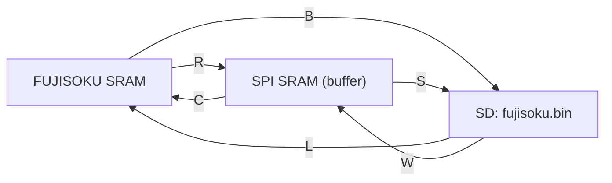

# ソフトウェア仕様（FUJISOKU_SRAM_COPY.ino）

シルバー編機のメモリカード（FUJISOKU SRAM）を、シリアルコマンドで SPI SRAM / SD カードとの間でコピー・照合するユーティリティです。ハード構成は [hardware.md](hardware.md) を参照してください。

## 1. 概要

- 操作はシリアルコンソール（115200 bps）からの **1 文字コマンド**です。
- 扱うデータは **0x0000〜0x7FFF の 32 KB**（`fujisoku.bin` と同じ並び）です。
- 3 つのメモリ（FUJISOKU SRAM / SPI SRAM / SD の `fujisoku.bin`）の間で転送・比較します。



## 2. ビルド環境

| 項目 | 内容 |
|---|---|
| IDE | Arduino IDE（スケッチフォルダ名 = `FUJISOKU_SRAM_COPY`） |
| ライブラリ | SPI、Adafruit GFX Library、Adafruit ILI9341、XPT2046_Touchscreen、SdFat（v2 系の `FsFile`） |
| ボード | 未記載（要追記）。`<iostream>` を include しているため、AVR 系（Uno など）ではビルドできない見込みで、32 ビットボードが前提です |
| シリアル | 115200 bps |

SD カード（`CS_SDcard` = D7）が初期化できないと、`setup()` で `SD.initErrorHalt()` の後に `while (1);` で停止します。起動時は SD カードを挿入しておく必要があります。

## 3. 動作の流れ

### 3.1 `setup()`

1. シリアル開始、`"FUJISOKU Memory Card!"` を表示。
2. `SPI.begin()`、各 /CS を出力・High に設定、D5 で nRESET パルス。
3. `tft.begin()`、`setRotation(0)`。
4. MCP23S17 の初期化（[hardware.md §3.2](hardware.md#32-初期化setup)）。
5. `SD.begin(CS_SDcard)`。失敗時は停止。

### 3.2 `loop()`

1. メニュー 5 行を表示（毎周期。1 周期 = 約 1 秒）。
2. `Serial.available() > 0` なら **1 文字だけ**読み、コマンドを実行（コマンド実行中は割り込めません）。
3. ch7/ch6 を待機状態（データ入力、アドレス入力、制御線全非選択 `0x3F`）に戻す。
4. `delay(1000)`。

複数の文字を続けて送ると、1 周期につき 1 文字ずつ処理されます。改行コードも 1 文字として読み捨てられます（`default` 分岐）。

## 4. コマンド一覧

| キー | 動作 | 転送元 → 転送先 | 破壊的操作 |
|---|---|---|---|
| `R` | カード読み出し | FUJISOKU → SPI SRAM | SPI SRAM を `0xFF` で消去してから書き込み |
| `C` | カード書き戻し | SPI SRAM → FUJISOKU | **FUJISOKU を `0xFF` で消去してから書き込み** |
| `X` | 比較 | SPI SRAM ↔ FUJISOKU | なし |
| `S` | 保存 | SPI SRAM → SD | `fujisoku.bin` を削除して再作成 |
| `W` | 読み込み | SD → SPI SRAM | SPI SRAM を上書き |
| `B` | バックアップ | FUJISOKU → SD | `fujisoku.bin` を削除して再作成 |
| `L` | ロード | SD → FUJISOKU | **FUJISOKU を上書き** |
| `V` | 照合 | SD ↔ FUJISOKU | なし |
| `T` | SPI SRAM 自己診断 | SPI SRAM のみ | 試験領域を書き換えて復元 |

メニューに表示される `E`（SPI SRAM 消去）と `e`（FUJISOKU 消去）は、**`switch` に処理がなく未実装**です。

> `SPI_SRAM` を定義してビルドすると、「SPI SRAM」として扱っている部分が並列 62256 SRAM に切り替わります（名前が逆の意味になっている点に注意）。

### 4.1 使い方の例

| 目的 | 手順 |
|---|---|
| カードを SD にバックアップして検証 | `B` → 完了後 `V` → `VERIFY OK` を確認 |
| SD からカードへ書き戻して検証 | `L` → 完了後 `V` → `VERIFY OK` を確認 |
| カードの内容を SPI SRAM に取り込んで確認 | `R` → `X` |
| SPI SRAM が動いているか調べる | `T` |

## 5. ファイル仕様（`fujisoku.bin`）

| 項目 | 内容 |
|---|---|
| ファイル名 | `fujisoku.bin`（`loop()` の `sfilename = "fujisoku"` に `.bin` を付加。8 文字 + `.bin`） |
| 場所 | SD カードのルート |
| サイズ | 32768 バイト（0x8000）固定 |
| 形式 | 生データ。オフセット N のバイト = メモリのアドレス N。ヘッダ・チェックサムなし |
| 既存ファイル | `S`/`B` は削除して再作成（確認なし）。`W`/`L`/`V` はファイルが無ければメッセージを出して終了 |

## 6. 出力フォーマット

| コマンド | 出力 |
|---|---|
| `R` | `Erase SRAM:` → `READ Silver Reed Memory Card:` → 16 バイトごとに `R%04X:` + `XX:` × 16 |
| `C` | `Erase FUJISOKU SRAM:` → `Copy Silver Reed Memory Card:` → 16 バイトごとに `C%04X:` + `XX:` × 16 |
| `X` | `Compare Silver Reed Memory Card:` → 128 バイトごとに `X%04X:` + 1 バイト 1 文字（一致 `.` / 不一致 `X`）。合計は表示しない |
| `S` / `B` | `Save <デバイス名> -> SD card : fujisoku.bin` → 1024 バイトごとに `NNSDW%04lX:` + `XX:` × 1024 → `SAVEが完了しました` |
| `W` / `L` | `Write SD DATA -> <デバイス名> : fujisoku.bin` → 256 バイトごとに `SDC%04lX:` + `XX:` × 256 → `コピーが完了しました` |
| `V` | `Verify SD <-> <デバイス名> : fujisoku.bin` → 128 バイトごとに `V%04lX:` + `.` / `X` → 不一致の先頭 8 件 → 判定行（下記） |
| `T` | 経路ごとに RDMR 値・読み戻し 16 バイト・判定（下記） |

`<デバイス名>` は `SPI SRAM` または `FUJISOKU SRAM`。

### 6.1 `V` の判定

| 結果 | 出力 |
|---|---|
| 全一致 | `VERIFY OK: 32768 bytes all match` |
| 不一致あり | 先頭 8 件を `  AAAA: SD=xx MEM=yy` 形式で表示し、`VERIFY NG: mismatch = n / 32768 bytes` |
| ファイルが 32 KB 未満 | `NG: ファイルが 32KB (0x8000) に満たない` で中断 |
| ファイルが 32 KB 超 | `NG: ファイルが 32KB より大きい`（全バイト一致でも NG） |
| ファイルなし | `ファイルが存在しません` |

### 6.2 `T` の出力例と読み方

（数値は説明用の例です。実機の出力ではありません。）

```
SPI SRAM /CS=D6      : RDMR=40
  readback:A0:A1:A2:A3:A4:A5:A6:A7:A8:A9:AA:AB:AC:AD:AE:AF:
  PASS
SPI SRAM /CS=MCP GPB5: RDMR=FF
  readback:FF:FF:FF:FF:FF:FF:FF:FF:FF:FF:FF:FF:FF:FF:FF:FF:
  FAIL mismatches=64/64
```

- 試験は 0x0000〜0x000F と 0x7FF0〜0x7FFF に、パターンとその反転を書いて読み戻します（合計 64 バイト比較）。試験前の内容は復元します。
- `RDMR` はモードレジスタの値です。応答があれば電源投入直後は `0x40` が目安で、`0xFF` は無応答（/CS 未接続・MISO が High のまま）を疑います（上の例は D6 経路が実配線の場合）。
- `PASS` になった経路が実際の /CS 配線です。

## 7. 関数リファレンス

### 7.1 コマンド処理

| 関数 | 役割 |
|---|---|
| `read_silver_memorycard()` | `R`。SPI SRAM を `0xFF` で消去し、FUJISOKU → SPI SRAM へ 32 KB コピー |
| `copy_silver_memorycard()` | `C`。FUJISOKU を `0xFF` で消去し、SPI SRAM → FUJISOKU へ 32 KB コピー |
| `compare_silver_memorycard()` | `X`。SPI SRAM と FUJISOKU を 1 バイトずつ比較して `.` / `X` を表示 |
| `save_sdcard_silver_memorycard(name, dev)` | `S` / `B`。`dev` のメモリ → SD。1024 バイト単位で書き込み、書き込み失敗時は中断 |
| `write_sdcard_silver_memorycard(name, dev)` | `W` / `L`。SD → `dev` のメモリ。EOF が来たら中断 |
| `verify_sdcard_silver_memorycard(name, dev)` | `V`。SD の 128 バイトずつ読み、`dev` と比較。不一致数と先頭 8 件を記録 |
| `test_spi_sram()` | `T`。D6 経路と MCP B5 経路の両方で SPI SRAM を試験 |

### 7.2 デバイス抽象化

| 関数 | 役割 |
|---|---|
| `dev_read(dev, addr)` / `dev_write(dev, addr, dat)` | `DEV_SPI_SRAM`（= 0）または `DEV_FUJISOKU`（= 1）への 1 バイト読み書き |
| `dev_name(dev)` | 表示名（`SPI SRAM` / `FUJISOKU SRAM`） |
| `spi_sram_rd` / `spi_sram_wr` / `spi_sram_rdmr` | `T` 用。`path` 0 = D6、1 = MCP B5 |

### 7.3 ハードウェアアクセス

| 関数 | 役割 |
|---|---|
| `read_mcp_register(ch, addr)` / `write_mcp_register(ch, addr, dat)` | MCP23S17 のレジスタ読み書き（オペコード `0x41/0x40 + ch*2`） |
| `set_mcp_sram_address(addr, cs)` | ch6 にアドレス下位 16 ビットを出力し、ch7 B に選択値 + A17/A16 を出力 |
| `read_fujisoku(addr)` / `write_fujisoku(addr, dat)` | FUJISOKU の 1 バイト読み書き（手順は [hardware.md §5](hardware.md#5-fujisoku-メモリカード)） |
| `read_sram(addr)` / `write_sram(addr, dat)` | 62256 の 1 バイト読み書き |
| `read_spi_sram_byte(addr)` / `write_spi_sram_byte(addr, dat)` | SPI SRAM（/CS = D6）の 1 バイト読み書き |

### 7.4 使われていないコード

次の関数・定義は現在のコマンドから呼ばれていません。

- SPI SRAM（MCP 経由 /CS）: `read_spi_sram4MCP_byte`、`write_spi_sram4MCP_byte`、`*_spi_sram4MCP_seq`、`set_spi_sram4MCP_*_mode`（`T` コマンドは `*4MCP_byte` を使用）
- SPI SRAM（連続・モード）: `read_spi_sram_seq`、`write_spi_sram_seq`、`set_spi_sram_read_mode`、`set_spi_sram_write_mode`
- TFT・タッチ: `draw_button`、`is_in_area`、`is_touch_button`、`caliblation`、`drawCrossPoint`、`convert_x`、`convert_y`、`print_tft`、`print_tft2`、キーボタンの配列
- その他: `read_IOCR`、`hexdump`、`MCP_IODIR_*` 定義、`CS_FSRAM_512`

## 8. 既知の注意点

1. メニューの `E` / `e` は未実装です。
2. `SPI_SRAM` マクロは、**定義すると SPI SRAM ではなく並列 62256 を使います**（名前と意味が逆）。
3. 転送は 1 バイトごとにアドレスと制御線を設定し直すため低速です。ログ出力（16 進ダンプ）も時間がかかります。
4. `SPI.transfer()` を `beginTransaction` なしで使っています。SD（SdFat の SPI 設定）と同一バスのため、SD 利用後に SPI 設定が引き継がれる可能性があります。**未検証**ですが、`V` で原因不明の不一致が出る場合は確認してください。
5. 起動時に SD カードが無いと停止します。
6. `B` と `S` は同じ `fujisoku.bin` を上書きします（確認なし）。
7. ハード側の要確認事項は [hardware.md §9](hardware.md#9-要確認事項) にまとめています。
