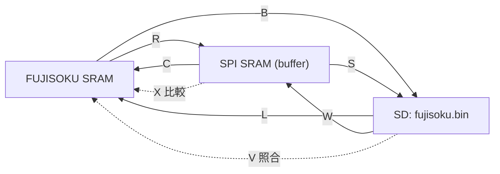

# ソフトウェア仕様（FUJISOKU_SRAM_COPY.ino）

シルバー編機のメモリカード（FUJISOKU SRAM）を、シリアルコマンドで SPI SRAM / SD カードとの間でコピー・照合するユーティリティの詳細仕様です。ハード構成と結線は [hardware.md](hardware.md) を参照してください。

> 仕様はスケッチ（`FUJISOKU_SRAM_COPY/FUJISOKU_SRAM_COPY.ino`）を読んで作成し、PC 上のスタブ付きビルドとレジスタモデルで動作を確認したものです（§13）。**実機では確認していません。**

## 1. 概要

- 操作はシリアルコンソール（115200 bps）からの **1 文字コマンド**です。
- 扱うデータは **0x0000〜0x7FFF の 32 KB**（`fujisoku.bin` と同じ並び）です。
- 3 つのメモリ（FUJISOKU SRAM / SPI SRAM / SD の `fujisoku.bin`）の間で転送・比較します。
- 1 バイトずつ MCP23S17 経由でバスを駆動するため低速です。32 KB の転送でシリアル出力だけでも約 9〜10 秒（115200 bps の理論値）かかります。



## 2. ソース構成

行番号は現行コミット時点の目安です。

| 範囲 | 内容 |
|---|---|
| 1〜8 | `#include` |
| 10〜131 | `#define`（§5） |
| 133〜180 | TFT・タッチ・SD のオブジェクト、`BUTTON`、キー配列、プロトタイプ（§6） |
| 182〜259 | `setup()`（§7.1） |
| 261〜318 | `loop()`（§7.2） |
| 320〜376 | コメントアウトされた旧コード（`SdFileList` ほか） |
| 378〜471 | `read_silver_memorycard` / `copy_silver_memorycard` / `compare_silver_memorycard` |
| 473〜599 | `save_sdcard_silver_memorycard` / `write_sdcard_silver_memorycard` |
| 601〜629 | `dev_read` / `dev_write` / `dev_name` |
| 631〜718 | `verify_sdcard_silver_memorycard` |
| 720〜864 | MCP23S17 とメモリのアクセス（`//Hardware Control`） |
| 866〜940 | `T` の補助関数と `test_spi_sram` |
| 942〜1028 | SPI SRAM の連続・モード関数（未使用） |
| 1030〜1277 | TFT・タッチ関連、`hexdump`、コメントアウトされたコード（未使用） |

## 3. ビルド環境

| 項目 | 内容 |
|---|---|
| IDE | Arduino IDE（スケッチフォルダ名 = `FUJISOKU_SRAM_COPY`） |
| ライブラリ | SPI、Adafruit GFX Library、Adafruit ILI9341、XPT2046_Touchscreen、SdFat（v2 系の `FsFile`） |
| ボード | Arduino UNO R4（ハード記事に記載）。**UNO R4 でのビルドは未検証** |
| シリアル | 115200 bps |
| 不要な include | `<unistd.h>`、`<fcntl.h>`、`<iostream>` は使用していません |

- `BUTTON` 型を引数に取る関数は、Arduino IDE の自動プロトタイプ生成が効かないため、スケッチ内に手書きのプロトタイプがあります。
- SD カード（`CS_SDcard` = D7）が初期化できないと `setup()` で停止します。起動時は SD カードを挿入しておく必要があります。

## 4. コマンド一覧

| キー | 動作 | 転送元 → 転送先 | 破壊的操作 |
|---|---|---|---|
| `R` | カード読み出し | FUJISOKU → SPI SRAM | SPI SRAM を `0xFF` で消去してから書き込み |
| `C` | カード書き戻し | SPI SRAM → FUJISOKU | **FUJISOKU を `0xFF` で消去してから書き込み** |
| `X` | 比較 | SPI SRAM ↔ FUJISOKU | なし |
| `S` | 保存 | SPI SRAM → SD | `fujisoku.bin` を削除して再作成 |
| `W` | 読み込み | SD → SPI SRAM | SPI SRAM を上書き |
| `B` | バックアップ | FUJISOKU → SD | `fujisoku.bin` を削除して再作成 |
| `L` | ロード | SD → FUJISOKU | **FUJISOKU を上書き** |
| `V` | 照合 | SD ↔ FUJISOKU | なし |
| `T` | SPI SRAM 自己診断 | SPI SRAM のみ | 試験領域を書き換えて復元 |

メニューに表示される `E`（SPI SRAM 消去）と `e`（FUJISOKU 消去）は、**`switch` に処理がなく未実装**です。

> `SPI_SRAM` を定義してビルドすると、「SPI SRAM」として扱っている部分が並列 62256 SRAM に切り替わります（名前が逆の意味になっている点に注意）。

### 4.1 使い方の例

| 目的 | 手順 |
|---|---|
| カードを SD にバックアップして検証 | `B` → 完了後 `V` → `VERIFY OK` を確認 |
| SD からカードへ書き戻して検証 | `L` → 完了後 `V` → `VERIFY OK` を確認 |
| カードの内容を SPI SRAM に取り込んで確認 | `R` → `X` |
| SPI SRAM が動いているか調べる | `T` |

`C` は先にカードを消去します。SPI SRAM に正しい内容が入っていること（直前に `R` か `W` を実行したこと）を確認してから使ってください。

## 5. 定義（`#define`）一覧

### 5.1 MCP23S17

| 定義名 | 値 | 内容 |
|---|---|---|
| `MCP23x17_OPE_WRITE` | `0x40` | 書き込みオペコード（実際は `+ ch*2`） |
| `MCP23x17_OPE_WRITE_A2` | `0x48` | A2=1 用の書き込みオペコード（初期化のみ） |
| `MCP23x17_OPE_READ` | `0x41` | 読み出しオペコード（実際は `+ ch*2`） |
| `MCP_ALL_INPUT` | `0xFF` | 全ビット入力 |
| `MCP_ALL_OUTPUT` | `0x00` | 全ビット出力 |
| `MCP7_PORT_PULUP` | `0xFF` | 定義のみ（未使用） |
| `MCP23x17_IOCR_BANK0` | `0x0A` | 初期化時の IOCON アドレス（BANK=0） |

レジスタアドレス（BANK=1）。BANK=0 版の定義は `/* */` 内に残っています。

| 定義名 | 値 | 使用 |
|---|---|---|
| `MCP23x17_DDR_A` / `MCP23x17_DDR_B` | `0x00` / `0x10` | 使用 |
| `MCP23x17_GPUP_A` / `MCP23x17_GPUP_B` | `0x06` / `0x16` | 初期化で使用 |
| `MCP23x17_GPIO_A` / `MCP23x17_GPIO_B` | `0x09` / `0x19` | 使用 |
| `MCP23x17_OLAT_A` / `MCP23x17_OLAT_B` | `0x0A` / `0x1A` | 使用 |
| `MCP23x17_IOCR` | `0x05` | `read_IOCR` のみ（未使用） |

その他（`MCP23x17_POL_*`、`MCP23x17_GPINTEN_*`、`MCP23x17_DEFVAL_*`、`MCP23x17_INTCON_*`、`MCP23x17_IOCR_B`、`MCP23x17_INTF_*`、`MCP23x17_INTCAP_*`）は定義のみです。

IOCON のビット（`IOCR_*`）: `IOCR_BANK1` = `0x80`、`IOCR_MIRROR` = `0x40`、`IOCR_SEQOP` = `0x20`、`IOCR_DISSLW` = `0x10`、`IOCR_HAEN` = `0x08`、`IOCR_ODR` = `0x04`、`IOCR_INTPOL` = `0x02`、`IOCR_NI` = `0x01`。初期化では `IOCR_BANK1 + IOCR_HAEN + IOCR_ODR` = `0x8C` を書きます。

### 5.2 SPI SRAM

| 定義名 | 値 | 内容 |
|---|---|---|
| `SRAM_OPE_READ` | `0x03` | READ 命令 |
| `SRAM_OPE_WRITE` | `0x02` | WRITE 命令 |
| `REG_READ` | `0x05` | RDMR（モードレジスタ読み出し） |
| `REG_WRITE` | `0x01` | WRMR（モードレジスタ書き込み） |
| `MODE_RW_BYTE` | `0x00` | ダミーバイト送信値としても使用 |
| `MODE_RW_PAGE` | `0x40` | 未使用 |
| `MODE_RW_SEQ` | `0x80` | 未使用 |
| `SRAM_OPE_MODE` | `0xFF` | 未使用 |

### 5.3 ピン

| 定義名 | 値 | 内容 |
|---|---|---|
| `CS_TFT` | 10 | ILI9341 /CS |
| `DC_TFT` | 9 | ILI9341 DC |
| `CS_touch` | 8 | XPT2046 /CS |
| `CS_SDcard` | 7 | SD /CS |
| `CS_SRAM_512` | 6 | SPI SRAM /CS |
| `CS_RESET` | 5 | MCP23S17 /RESET |
| `CS_MCP23S17` | 4 | MCP23S17 /CS |
| `CS_FSRAM_512` | 1 | 未使用 |
| `IRQ_MCP` | 3 | 入力設定のみ |
| `IRQ_touch` | 2 | 入力設定のみ |

### 5.4 MCP チャネル

| 定義名 | 値 | 内容 |
|---|---|---|
| `CH_MCP_BUS_ADDRESS` | 6 | アドレスバス |
| `CH_MCP_BUS_DATA` | 7 | データバス |
| `CH_MCP_CONTROL` | 7 | 制御線 + A16/A17 |

### 5.5 ch7 ポート B の制御値

ビットの意味はスケッチのコメントに基づきます。記事の配線とは一致しません（[hardware.md §6](hardware.md#6-ch7-ポート-b-記事とスケッチの食い違い)）。

| 定義名 | 値 | 用途 |
|---|---|---|
| `DISENABLE_SRAM` | `0x3F` | 全制御線 非選択（起動時・待機時） |
| `DISENABLE_FUJISOKU` | `0x3E` | FUJISOKU アクセス終了時 |
| `ENABLE_FUJISOKU_nCS1_CS2` | `0x2F` | FUJISOKU 選択（B4 = Low、B0 = High） |
| `ENABLE_SRAM_nCS` | `0x3E` | 62256 選択（B0 = Low） |
| `AND_ENABLE_nWE` | `0xF7` | B3 を Low（書き込みパルス） |
| `AND_ENABLE_FUJISOKU_nOE` | `0xFD` | B1 を Low |
| `AND_ENABLE_SRAM_nOE` | `0xFB` | B2 を Low |
| `AND_ENABLE_SPI_SRAM` | `0xDF` | B5 を Low |
| `MCP_IODIR_PE1_CONNECT` | `0xDB` | 未使用 |

`MCP_IODIR_FUJISOKU_CONNECT` と `MCP_IODIR_SRAM_CONNECT` はどちらも `0x00` で、未使用です。

### 5.6 その他

| 定義名 | 値 | 内容 |
|---|---|---|
| `SRAM_ERASE` | `0xFF` | 消去値 |
| `DEV_SPI_SRAM` | 0 | `dev` 引数: SPI SRAM（`SPI_SRAM` 定義時は 62256） |
| `DEV_FUJISOKU` | 1 | `dev` 引数: FUJISOKU |
| `SPI_SRAM` | 未定義 | コメントアウト。定義すると 62256 側に切り替わる |

## 6. グローバルオブジェクト

| 名前 | 型 | 内容 |
|---|---|---|
| `tft` | `Adafruit_ILI9341` | `CS_TFT`、`DC_TFT`。`setup()` で `tft.begin()`、`tft.setRotation(0)` のみ |
| `ts` | `XPT2046_Touchscreen` | `CS_touch`、`IRQ_touch`。コマンドからは使わない |
| `BUTTON` | 構造体 | `x`、`y`、`w`、`t`、`key`。タッチキー用 |
| `key_C`〜`key_3`、`key_array[16]` | `BUTTON` | 16 進キーの配置。未使用 |
| `caliblation_x1`、`caliblation_y1`、`delta_x`、`delta_y` | `float` | タッチ補正値。未使用 |
| `SD` | `SdFat` | SD カード |
| `myFile` | `FsFile` | S/W/B/L/V が共用するファイルハンドル |

## 7. 起動と周期処理

### 7.1 `setup()`

| # | 処理 | 内容 |
|---|---|---|
| 1 | シリアル | `Serial.begin(115200)`、`"FUJISOKU Memory Card!"` を表示 |
| 2 | SPI | `SPI.begin()` |
| 3 | ピン設定 | 出力: `CS_TFT`、`CS_touch`、`CS_SDcard`、`CS_SRAM_512`、`CS_RESET`、`CS_MCP23S17`。入力: `IRQ_touch`、`IRQ_MCP` |
| 4 | /CS 非選択 | 上の出力ピン 6 本を High |
| 5 | /RESET | `CS_RESET` を Low → High（待ち時間なし） |
| 6 | TFT | `tft.begin()`、`tft.setRotation(0)` |
| 7 | IOCON | オペコード `0x40` と `0x48` で、アドレス `0x0A` に `0x8C` を書く（以後 BANK=1） |
| 8 | 全チャネル初期化 | ch0〜ch7 に各 6 回: OLAT_A/B = `0x00`、DDR_A/B = `0xFF`、GPUP_A/B = `0xFF`（計 48 回） |
| 9 | バス設定 | ch7 DDR_A、ch6 DDR_A/B = 入力。ch7 DDR_B = 出力。ch7 GPIO_B = `0x3F` |
| 10 | SD | `"Initializing SD card..."` → `SD.begin(CS_SDcard)`。失敗: `"initialization failed!"`、`SD.initErrorHalt()`、`while (1);` で停止。成功: `"initialization done."` |

手順 9 で ch7 DDR_B を出力にした時点の OLAT_B は `0x00` なので、GPIO_B に `0x3F` を書くまでの短時間は全制御線が Low で出力されます（実機の影響は未確認）。`dat` と `strhex` は未使用です。

### 7.2 `loop()`

1 周期の流れ:

1. メニュー 5 行を表示（毎周期）。

   ```
   R:FUJISOKU SRAM -> SPI SRAM, C:SPI SRAM -> FUJISOKU SRAM
   S:SPI SRAM -> SD , W:SD -> SPI SRAM
   E:Erase SPI SRAM , e:Erase FUJISOKU SRAM
   X:Compare SPI SRAM <-> FUJISOKU SRAM , T:Test SPI SRAM
   B:FUJISOKU SRAM -> SD , L:SD -> FUJISOKU SRAM , V:Verify SD <-> FUJISOKU SRAM
   ```

2. `Serial.available() > 0` なら **1 文字だけ**読み、`switch` で振り分け（`default` は何もしない）。ファイル名は `char sfilename[16] = "fujisoku"` を渡します。
3. 待機状態に戻す: ch7 DDR_A、ch6 DDR_A/B = 入力、ch7 DDR_B = 出力、ch7 GPIO_B = `0x3F`。
4. `delay(1000)`。

- コマンド実行中は次のキー入力を受け付けません。複数文字を続けて送ると、1 周期につき 1 文字ずつ処理されます。
- 改行コードも 1 文字として読み捨てられます（`default`）。
- ローカル変数 `i`、`ii`、`iii`、`dat` は未使用です。

## 8. コマンド詳細

共通: アドレスは 0x0000〜0x7FFF。`<dev>` は `SPI SRAM`（`DEV_SPI_SRAM`）または `FUJISOKU SRAM`（`DEV_FUJISOKU`）。MCP の回数は 1 バイトあたり `read_fujisoku` 11 回、`write_fujisoku` 12 回（[hardware.md §7](hardware.md#7-アクセスシーケンス実測トレース)）で、下表は 32768 バイト分の回数です（コードから計算）。

| キー | 関数 | 引数 | 処理量（MCP トランザクション） |
|---|---|---|---|
| `R` | `read_silver_memorycard()` | なし | 360,448（FUJISOKU 読み）+ SPI SRAM 書き 65,536 回 |
| `C` | `copy_silver_memorycard()` | なし | 786,432（消去 393,216 + 書き 393,216）+ SPI SRAM 読み 32,768 回 |
| `X` | `compare_silver_memorycard()` | なし | 360,448 + SPI SRAM 読み 32,768 回 |
| `S` | `save_sdcard_silver_memorycard(sfilename, DEV_SPI_SRAM)` | ファイル名、dev | SPI SRAM 読み 32,768 回 + SD 書き 32 回（1024 バイト） |
| `W` | `write_sdcard_silver_memorycard(sfilename, DEV_SPI_SRAM)` | ファイル名、dev | SPI SRAM 書き 32,768 回 + SD 1 バイト読み 32,768 回 |
| `B` | `save_sdcard_silver_memorycard(sfilename, DEV_FUJISOKU)` | ファイル名、dev | 360,448 + SD 書き 32 回 |
| `L` | `write_sdcard_silver_memorycard(sfilename, DEV_FUJISOKU)` | ファイル名、dev | 393,216 + SD 1 バイト読み 32,768 回 |
| `V` | `verify_sdcard_silver_memorycard(sfilename, DEV_FUJISOKU)` | ファイル名、dev | 360,448 + SD 読み 256 回（128 バイト）+ 末尾確認 1 回 |
| `T` | `test_spi_sram()` | なし | D6 経路と MCP B5 経路の両方で SPI SRAM を試験 |

### 8.1 `R` FUJISOKU → SPI SRAM

1. `"Erase SRAM:"` を表示し、0x0000〜0x7FFF の SPI SRAM を `0xFF` で埋める。
2. `"READ Silver Reed Memory Card:"` を表示する。
3. 16 バイト（`UNIT_SIZE` = `0x10`）ごとに `R%04X:` を表示し、`read_fujisoku()` で読んだ値を SPI SRAM に書いて、`XX:` を表示する。

読み戻し検証や異常検出はありません。結果の確認は `X` で行います。

### 8.2 `C` SPI SRAM → FUJISOKU

1. `"Erase FUJISOKU SRAM:"` を表示し、`write_fujisoku()` で 0x0000〜0x7FFF を `0xFF` で埋める。
2. `"Copy Silver Reed Memory Card:"` を表示する。
3. 16 バイトごとに `C%04X:` を表示し、SPI SRAM から読んだ値を `write_fujisoku()` で書き、`XX:` を表示する。

消去してから書くため、途中で止めるとカードの内容は失われます。

### 8.3 `X` 比較

128 バイト（`UNIT_SIZE` = `0x80`）ごとに `X%04X:` を表示し、SPI SRAM と FUJISOKU の同じアドレスを読み比べて、一致なら `.`、不一致なら `X` を 1 文字ずつ表示します。一致数・不一致数の合計は表示しません。

### 8.4 `S` / `B` メモリ → SD

1. ファイル名を `"%.8s.bin"` で組み立てる（`fujisoku.bin`）。
2. `"Save <dev> -> SD card : fujisoku.bin"` を表示する。
3. 既存ファイルがあれば削除（`"ファイル削除成功"`。失敗なら `"ファイル削除失敗"` で中断）。
4. `O_WRONLY | O_CREAT | O_TRUNC` で開く（失敗: `"ファイルのオープンに失敗しました"`）。
5. 1024 バイト（`BUF_SIZE` = `0x400`）× 32 回: `%02uSDW%04lX:` を表示し、`dev_read()` で 1024 バイト読んで `XX:` を表示し、SD へ書く。書き込み長が違えば `"書き込みエラー"` で閉じて中断。
6. 閉じて `"SAVEが完了しました"` を表示する。

### 8.5 `W` / `L` SD → メモリ

1. ファイル名を組み立て、`"Write SD DATA -> <dev> : fujisoku.bin"` を表示する。
2. ファイルが無ければ `"ファイルが存在しません"`、開けなければ `"ファイルのオープンに失敗しました"` で終了する。
3. 先頭から 256 バイト（`UNIT_SIZE` = `0x100`）× 128 回: `SDC%04lX:` を表示し、1 バイトずつ読んで `dev_write()` で書き、`XX:` を表示する。
4. EOF が来たら `"予期しない EOF"` を表示して中断する（それまでに書いた分は残る）。
5. 閉じて `"コピーが完了しました"` を表示する。

ファイルが 32 KB より大きい場合、超過分は無視されます。書き込み後の照合は行わないので、`L` の後は `V` を実行してください。

### 8.6 `V` 照合（SD ↔ FUJISOKU）

1. ファイル名を組み立て、`"Verify SD <-> <dev> : fujisoku.bin"` を表示する。
2. ファイルが無い／開けない場合は §8.5 と同じメッセージで終了する。
3. 128 バイト（`UNIT_SIZE` = `0x80`）× 256 回: SD から 128 バイト読み（短ければ `"NG: ファイルが 32KB (0x8000) に満たない"` で中断）、`V%04lX:` を表示し、`dev_read()` と比べて `.` / `X` を表示する。不一致の先頭 8 件のアドレスと値を記録する。
4. 32 KB を超えるデータがファイルに残っているかを 1 バイト読んで確認する。
5. 記録した不一致を `  AAAA: SD=xx MEM=yy` 形式で表示する。
6. 判定行を表示する（§10.1）。

ファイルが短くて中断した場合、不一致の一覧と判定行は表示されません。

### 8.7 `T` SPI SRAM 自己診断

`path` = 0（/CS = D6）と 1（/CS = MCP ch7 B5）の順に、次を行います。

1. `"SPI SRAM /CS=D6      : RDMR="` または `"SPI SRAM /CS=MCP GPB5: RDMR="` に続けて、`spi_sram_rdmr()` の値を表示する。
2. 0x0000〜0x000F と 0x7FF0〜0x7FFF の 32 バイトを退避する。
3. パターン `0xA0 + i` を書いて読み戻し、次に反転パターンを書いて読み戻して比較する（計 64 バイト）。1 回目の 0x0000〜0x000F の読み戻し値は `  readback:` の後に表示する。
4. 退避した内容を書き戻す。
5. `"  PASS"` または `"  FAIL mismatches=n/64"` を表示する。

## 9. ファイル仕様（`fujisoku.bin`）

| 項目 | 内容 |
|---|---|
| ファイル名 | `fujisoku.bin`（`loop()` の `sfilename = "fujisoku"` に `.bin` を付加。先頭 8 文字 + `.bin`） |
| 場所 | SD カードのルート |
| サイズ | 32768 バイト（0x8000）固定 |
| 形式 | 生データ。オフセット N のバイト = メモリのアドレス N。ヘッダ・チェックサムなし |
| 既存ファイル | `S`/`B` は削除して再作成（確認なし）。`W`/`L`/`V` はファイルが無ければメッセージを出して終了 |

## 10. 出力フォーマット

| コマンド | 出力 |
|---|---|
| `R` | `Erase SRAM:` → `READ Silver Reed Memory Card:` → 16 バイトごとに `R%04X:` + `XX:` × 16 |
| `C` | `Erase FUJISOKU SRAM:` → `Copy Silver Reed Memory Card:` → 16 バイトごとに `C%04X:` + `XX:` × 16 |
| `X` | `Compare Silver Reed Memory Card:` → 128 バイトごとに `X%04X:` + 1 バイト 1 文字（一致 `.` / 不一致 `X`）。合計は表示しない |
| `S` / `B` | `Save <デバイス名> -> SD card : fujisoku.bin` → 1024 バイトごとに `NNSDW%04lX:` + `XX:` × 1024 → `SAVEが完了しました` |
| `W` / `L` | `Write SD DATA -> <デバイス名> : fujisoku.bin` → 256 バイトごとに `SDC%04lX:` + `XX:` × 256 → `コピーが完了しました` |
| `V` | `Verify SD <-> <デバイス名> : fujisoku.bin` → 128 バイトごとに `V%04lX:` + `.` / `X` → 不一致の先頭 8 件 → 判定行 |
| `T` | 経路ごとに RDMR 値・読み戻し 16 バイト・判定 |

`<デバイス名>` は `SPI SRAM` または `FUJISOKU SRAM`。行数は `R`/`C` が 2048 行、`X`/`V` が 256 行、`W`/`L` が 128 行、`S`/`B` が 32 行です。

### 10.1 `V` の判定

| 結果 | 出力 |
|---|---|
| 全一致 | `VERIFY OK: 32768 bytes all match` |
| 不一致あり | 先頭 8 件を `  AAAA: SD=xx MEM=yy` 形式で表示し、`VERIFY NG: mismatch = n / 32768 bytes` |
| ファイルが 32 KB 未満 | `NG: ファイルが 32KB (0x8000) に満たない` で中断 |
| ファイルが 32 KB 超 | `NG: ファイルが 32KB より大きい`（全バイト一致でも NG） |
| ファイルなし | `ファイルが存在しません` |

### 10.2 `T` の出力例と読み方

（数値は説明用の例です。実機の出力ではありません。）

```
SPI SRAM /CS=D6      : RDMR=40
  readback:A0:A1:A2:A3:A4:A5:A6:A7:A8:A9:AA:AB:AC:AD:AE:AF:
  PASS
SPI SRAM /CS=MCP GPB5: RDMR=FF
  readback:FF:FF:FF:FF:FF:FF:FF:FF:FF:FF:FF:FF:FF:FF:FF:FF:
  FAIL mismatches=64/64
```

- `RDMR` はモードレジスタの値です。応答があれば電源投入直後は `0x40` が目安で、`0xFF` は無応答（/CS 未接続・MISO が High のまま）を疑います（上の例は D6 経路が実配線の場合）。
- `PASS` になった経路が実際の /CS 配線です。

## 11. 低レベルアクセス

MCP23S17 のレジスタ書き込みは 1 トランザクション 3 バイト（オペコード、レジスタ、値）、読み出しも 3 バイト（最後の 1 バイトが応答）です。`read_fujisoku` と `write_fujisoku` の全トランザクションは [hardware.md §7](hardware.md#7-アクセスシーケンス実測トレース) にあります。

| 関数 | MCP トランザクション | 備考 |
|---|---|---|
| `read_fujisoku` | 11（33 バイト） | |
| `write_fujisoku` | 12（36 バイト） | |
| `read_sram` | 11 | |
| `write_sram` | 12 | |
| `read_spi_sram_byte` / `write_spi_sram_byte` | 0 | SPI SRAM に 4 バイト |
| `write_spi_sram4MCP_byte` | 3 | SPI SRAM に 4 バイト |

OLAT_B を読んでから制御ビットを AND する方式のため、`set_mcp_sram_address()` が書いた A17/A16 を保ったまま /OE・/WE だけを動かします。

## 12. 関数リファレンス

### 12.1 コマンド処理

| 関数 | 呼び出し元 | 役割 |
|---|---|---|
| `read_silver_memorycard()` | `loop` | `R` |
| `copy_silver_memorycard()` | `loop` | `C` |
| `compare_silver_memorycard()` | `loop` | `X` |
| `save_sdcard_silver_memorycard(const char *sp_filename, uint8_t dev)` | `loop` | `S` / `B`。`dev_read` を使う |
| `write_sdcard_silver_memorycard(const char *sp_filename, uint8_t dev)` | `loop` | `W` / `L`。`dev_write` を使う |
| `verify_sdcard_silver_memorycard(const char *sp_filename, uint8_t dev)` | `loop` | `V`。`dev_read` を使う |
| `test_spi_sram()` | `loop` | `T` |

### 12.2 デバイス抽象化

| 関数 | 役割 |
|---|---|
| `dev_read(uint8_t dev, unsigned long address)` | `DEV_FUJISOKU` なら `read_fujisoku`、それ以外は SPI SRAM（`SPI_SRAM` 定義時は `read_sram`） |
| `dev_write(uint8_t dev, unsigned long address, uint8_t dat)` | 同上の書き込み |
| `dev_name(uint8_t dev)` | 表示名（`SPI SRAM` / `FUJISOKU SRAM`） |

### 12.3 ハードウェアアクセス

| 関数 | 役割 |
|---|---|
| `read_mcp_register(uint8_t ch, uint8_t address)` | MCP23S17 のレジスタ読み出し（オペコード `0x41 + ch*2`） |
| `write_mcp_register(uint8_t ch, uint8_t address, uint8_t dat)` | レジスタ書き込み（オペコード `0x40 + ch*2`） |
| `set_mcp_sram_address(unsigned long int address, uint8_t CS)` | ch6 DDR を出力にしてアドレス下位 16 ビットを出力し、ch7 GPIO_B に `CS` + A17/A16 を出力 |
| `read_fujisoku(unsigned long int address)` | FUJISOKU の 1 バイト読み出し |
| `write_fujisoku(unsigned long int address, uint8_t dat)` | FUJISOKU の 1 バイト書き込み |
| `read_sram(unsigned long int address)` | 62256 の 1 バイト読み出し |
| `write_sram(unsigned long int address, uint8_t dat)` | 62256 の 1 バイト書き込み |
| `read_spi_sram_byte(unsigned int address)` | SPI SRAM（/CS = D6）の 1 バイト読み出し |
| `write_spi_sram_byte(unsigned int address, uint8_t dat)` | SPI SRAM（/CS = D6）の 1 バイト書き込み |
| `read_spi_sram4MCP_byte(unsigned int address)` | SPI SRAM（/CS = MCP B5）の読み出し。`T` のみ |
| `write_spi_sram4MCP_byte(unsigned int address, uint8_t dat)` | 同書き込み。`T` のみ |

### 12.4 `T` の補助関数

| 関数 | 役割 |
|---|---|
| `spi_sram_rd(uint8_t path, unsigned int a)` / `spi_sram_wr(uint8_t path, unsigned int a, uint8_t d)` | `path` 0 = D6、1 = MCP B5 を切り替えて 1 バイト読み書き |
| `spi_sram_rdmr(uint8_t path)` | RDMR（`0x05`）でモードレジスタを読む |

### 12.5 使われていないコード

次の関数・定義は現在のコマンドから呼ばれていません。

- SPI SRAM（MCP 経由 /CS）: `read_spi_sram4MCP_seq`、`write_spi_sram4MCP_seq`、`set_spi_sram4MCP_read_mode`、`set_spi_sram4MCP_write_mode`（`T` は `*4MCP_byte` と `spi_sram_rdmr` のみ使用）
- SPI SRAM（連続・モード）: `read_spi_sram_seq`、`write_spi_sram_seq`、`set_spi_sram_read_mode`、`set_spi_sram_write_mode`
- TFT・タッチ: `draw_button`、`is_in_area`、`is_touch_button`、`caliblation`、`drawCrossPoint`、`convert_x`、`convert_y`、`print_tft`、`print_tft2`、キーボタンの配列
- その他: `read_IOCR`、`hexdump`、`MCP_IODIR_PE1_CONNECT`、`CS_FSRAM_512`

## 13. 検証状況

確認したこと（PC 上）:

- スタブヘッダ（Arduino、SPI、SdFat、TFT、タッチ）付きで警告付きビルドし、`-fsanitize=address,undefined` で `R`/`C`/`X`/`S`/`W`/`B`/`L`/`V`/`T` を模擬メモリに対して実行。
- `read_fujisoku` ほかの低レベル関数を、MCP23S17 のレジスタモデルに接続して SPI トランザクションを記録（[hardware.md §7](hardware.md#7-アクセスシーケンス実測トレース)）。
- 本資料の定数値・コマンド一覧・関数名・リンクを、スクリプトでスケッチと突き合わせ。

確認していないこと:

- 実機動作（UNO R4、MCP23S17、FUJISOKU カード、SPI SRAM、SD）。
- UNO R4 でのコンパイル。
- 実際の転送時間、信号タイミング。
- 記事の結線とスケッチ定数のどちらが実機か（[hardware.md §6](hardware.md#6-ch7-ポート-b-記事とスケッチの食い違い)）。

## 14. 既知の注意点

1. 制御線の割り当てが記事と食い違っています。記事の配線の実機に現行スケッチを使うと、カードを読み書きできないと読めます（[hardware.md §6](hardware.md#6-ch7-ポート-b-記事とスケッチの食い違い)）。
2. メニューの `E` / `e` は未実装です。
3. `SPI_SRAM` マクロは、**定義すると SPI SRAM ではなく並列 62256 を使います**（名前と意味が逆）。
4. `C` は先にカードを消去します。SPI SRAM の内容が正しいことを確認してから実行してください。
5. 転送は 1 バイトごとにアドレスと制御線を設定し直すため低速です。ログ出力（16 進ダンプ）も時間がかかります。
6. `SPI.transfer()` を `beginTransaction` なしで使っています。SD（SdFat の SPI 設定）と同一バスのため、SD 利用後に SPI 設定が引き継がれる可能性があります。**未検証**ですが、`V` で原因不明の不一致が出る場合は確認してください。
7. 起動時に SD カードが無いと停止します。
8. `B` と `S` は同じ `fujisoku.bin` を上書きします（確認なし）。
9. `setup()` の途中で、全制御線が Low で出力される短い期間があります（§7.1）。
10. `R`/`C`/`X` の `snprintf` は `unsigned long` を `%X` で整形しています。`long` と `int` が同じ幅の 32 ビットボードでは問題ありませんが、他のボードでは `%lX` に直してください。
11. `MODE_RW_PAGE` と `MODE_RW_SEQ` は 23LC512 のデータシートと割り当てが逆に見えます（未使用のため実害なし）。
12. `V` はメニュー上 FUJISOKU との照合のみです。関数自体は `DEV_SPI_SRAM` も受け付けます。
13. ハード側の要確認事項は [hardware.md §10](hardware.md#10-要確認事項) にまとめています。
