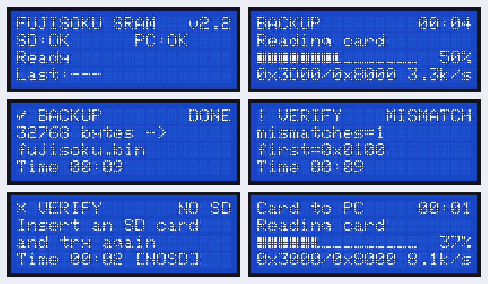

# ソフトウェア仕様（スケッチ v2.2）

対象: `FUJISOKU_SRAM_COPY/`（`FSU_VERSION` = 2.2）。配線は [hardware.md](hardware.md)、PC との通信は [protocol.md](protocol.md)、Web アプリは [webapp.md](webapp.md) を参照してください。

## 1. 概要

FUJISOKU SRAM カード（32KB、0x0000〜0x7FFF）を、次の相手との間でコピー・照合します。

| 相手 | 操作する場所 |
|---|---|
| PC のファイル | Web アプリ（`rd` / `wr` で PC 側が処理し、本体は読み書きだけ）。**カードの吸い出し・書き込み・比較の基本はこれ** |
| SD カードの `*.bin`（オプション） | 本体（`sd save` / `sd load` / `sd verify`、1 文字コマンド `B` `L` `V`） |
| SPI SRAM（一時保管） | 本体（`copy` / `cmp` / `erase`、1 文字コマンド `R` `C` `X` `E` `e`） |
| 62256（オプション、動作確認用） | 本体（対象 `p`、`test p` でバスの配線試験） |

本体にボタンは無く、操作はすべて PC から行います。状態と進捗は 20×4 の画面に表示し、同じ内容を LCD（オプション）と Web アプリに出します。

## 2. ソース構成

Arduino IDE ではフォルダ内の `.ino` がタブとして開かれ、メインのファイルを先頭に、残りを名前順につないで 1 つのプログラムとしてビルドされます。

| ファイル | 内容 |
|---|---|
| `FUJISOKU_SRAM_COPY.ino` | ライブラリの読み込み（LCD はオプションに応じて）、グローバル変数、`setup()`、`loop()` |
| `config.h` | **オプション部品の選択**（§3）、設定値、ピン、MCP23S17 のレジスタ、制御定数 |
| `hardware.ino` | MCP23S17 のレジスタ読み書き、`mcp_init()` / `bus_idle()`、カード・SPI SRAM・62256 の 1 バイト読み書き、`spi_sram_init()` |
| `storage.ino` | SD カードの状態管理（マウント、生存確認、抜けの検出）、ファイル名の組み立て、一覧。`USE_SD` のときだけ |
| `operations.ino` | 処理の枠組み（開始・段階・進捗・終了・中断）と各処理（コピー、比較、消去、SD 保存・書き込み・照合、自己診断、62256 のバス試験）。SD の処理は `USE_SD` のときだけ |
| `protocol.ino` | シリアルの行の受信、コマンドの振り分け、`rd` / `wr` / `fill`、PC 主導の表示（`ui`） |
| `lcd_ui.ino` | 画面（待機・進捗・結果）、LCD の検出と差分だけの書き換え、自作文字、PC への画面送信（`lcd`） |

## 3. 部品の構成とオプション

### 3.1 必須とオプション

| 区分 | 部品 | 設定 |
|---|---|---|
| 必須 | MCP23S17 × 2、FUJISOKU カードのスロット、**SPI SRAM（データの一時保管）** | - |
| オプション | SD カード（本体だけでの保存・照合・書き戻し） | `USE_SD` |
| オプション | 20×4 キャラクタ LCD（I2C） | `USE_LCD` |
| オプション | 62256 並列 SRAM（動作確認用） | `USE_SRAM62256` |

カードの吸い出し・書き込み・比較は Web アプリでできるので、SD カードと LCD はなくても使えます。

### 3.2 `config.h` のオプション

```c
#define USE_SD 1          // SD カード。0 で SD のコードと SdFat を外す
#define USE_LCD 1         // 20x4 キャラクタ LCD (I2C)。0 で LCD のコードとライブラリを外す
#define USE_SRAM62256 0   // 動作確認用の 62256。1 で対象 p と test p が使える
```

| 設定 | 1 のとき | 0 のとき |
|---|---|---|
| `USE_SD` | 本体だけでの SD 保存・照合・書き戻し（§7）。起動時にカードが無くても、合間に抜き差ししても動く | SD のコード（`storage.ino`、SD の処理、`SdFat` の読み込み）を入れない。`sd` `sdcheck` と `B` `L` `V` `S` `W` は `ERR DISABLED`。`status` は `sd=-`、待機画面は `SD:off` |
| `USE_LCD` | 起動時に LCD を探し、見つかれば表示する（見つからなければ LCD には送らない） | LCD のコードを入れない。LiquidCrystal I2C と Wire を読み込まない |
| `USE_SRAM62256` | 対象 `p`、`test p` が使える。`read_sram()` / `write_sram()` が入る | 62256 のコードを入れない。`p` を指定すると `ERR ARG` |

LCD の設定にかかわらず、本体は画面の内容を持ち続けるので、Web アプリには同じ画面が出ます。`hello` の応答（`lcd=20x4|none`、`sram62256=1|0`、`sdcard=1|0`）で、PC は構成を知ることができます。Web アプリは `sdcard=0` なら SD のタブを隠します。

3 つとも 0（SD・LCD なし、62256 なし）にすると、外部ライブラリなしでビルドできます。

各設定は `#ifndef` で囲んであるので、ビルド時に `-DUSE_SD=0` のように外から変えることもできます（テストではこれを使っています）。

D7（SD の /CS）は `USE_SD` が 0 でも出力・High にします。SD モジュールを付けたままでも、SPI の MISO を邪魔しません。

v1 の `SPI_SRAM` マクロ（SPI SRAM の代わりに 62256 を使う）は廃止しました。

## 4. ビルド

| 項目 | 内容 |
|---|---|
| ボード | Arduino UNO R4（Minima / WiFi） |
| ライブラリ | `USE_SD` が 1 なら SdFat（Bill Greiman、v2 系）、`USE_LCD` が 1 なら LiquidCrystal I2C（Frank de Brabander）。どちらも 0 なら外部ライブラリは不要 |
| 標準ライブラリ | SPI（`USE_LCD` が 1 のときは Wire も） |

### 4.1 設定値（`config.h`）

| 定義 | 既定値 | 内容 |
|---|---|---|
| `USE_SD` | `1` | §3.2 |
| `USE_LCD` | `1` | §3.2 |
| `USE_SRAM62256` | `0` | §3.2 |
| `LCD_I2C_ADDR` | `0x27` | LCD バックパックの I2C アドレス（`0x3F` の基板もある） |
| `RESULT_HOLD_MS` | `15000` | 結果画面を出しておく時間 |
| `SPI_BUS_HZ` | `4000000` | MCP23S17 / SPI SRAM の SPI クロック |
| `SD_ALIVE_CHECK_MS` | `1500` | 待機中に SD カードの応答を確かめる間隔 |
| `CHUNK_BYTES` | `64` | `rd` の 1 行、`wr` の最大バイト数 |
| `BLOCK_BYTES` | `256` | SD との読み書きの単位 |
| `SD_TMP_NAME` | `"FSU_TMP.TMP"` | バックアップ中の一時ファイル |

## 5. 起動と周期処理

### 5.1 `setup()`

1. `Serial.begin(115200)`（PC の接続は待たない）。
2. `SPI.begin()`、/CS ピンを出力・High、MCP23S17 の /RESET パルス。
3. `ui_begin()`: `USE_LCD` が 1 なら I2C で LCD を探し、見つかれば初期化して自作文字を登録する。起動画面を出す。
4. `mcp_init()`: MCP23S17 を BANK=1・HAEN にして全チャネルを初期化し、`bus_idle()`。
5. `spi_sram_init()`: SPI SRAM をバイトモードにする（[hardware.md §9.1](hardware.md#91-spi-sram必須データの一時保管)）。
6. `sd_mount()`（`USE_SD` のときだけ）: SD カードがあればマウント。無くても止まらない。
7. 待機画面を出し、`FUJISOKU SRAM Utility 2.2 ready (LCD 20x4, SD on, 62256 off). ...` を送る（LCD が無ければ `LCD none`、`USE_SD` が 0 なら `SD off`）。

### 5.2 `loop()`

`delay()` は使わず、次の 3 つを繰り返します。

| 関数 | 内容 |
|---|---|
| `proto_poll()` | シリアルから 1 行ずつ取り込んでコマンドを実行。PC 主導の表示が 8 秒止まったら表示を戻す |
| `ui_poll()` | 待機画面の SD / PC 表示の更新（0.2 秒ごと）、結果画面から待機画面への切り替え、`lcd on` のときの画面送信 |
| `sd_idle_check()` | （`USE_SD` のときだけ）SD が使える状態なら 1.5 秒ごとに応答を確かめ、抜かれたら `E SD 0` |

## 6. 処理（`operations.ino`）

### 6.1 対象メモリ

| 対象 | 定義 | コマンドの文字 | 読み書き |
|---|---|---|---|
| FUJISOKU カード | `DEV_FUJISOKU` | `f` | `read_fujisoku()` / `write_fujisoku()` |
| SPI SRAM | `DEV_SPI_SRAM` | `s` | `read_spi_sram_byte()` / `write_spi_sram_byte()`（/CS = D6） |
| 62256 | `DEV_SRAM62256` | `p` | `read_sram()` / `write_sram()`（`USE_SRAM62256` のときだけ） |

`dev_read()` / `dev_write()` / `dev_name()` が対象を振り分けます。

### 6.2 処理の枠組み

本体だけで行う処理は、すべて同じ流れです。

| 段階 | 関数 | PC への出力 | 画面 |
|---|---|---|---|
| 開始 | `op_start()` | - | 進捗画面（題名、内容） |
| 段階 | `op_phase()` | `S <段階>` | 2 行目 |
| 進捗 | `op_step()` | `P <済み> <合計>`（0.1 秒ごと） | 進捗バーと %（変わるたび）、アドレスと速度（0.5 秒ごと） |
| 終了 | `op_finish()` | `OK` / `NG` / `ERR` の 1 行 | 結果画面 |

- `op_step()` のたびに PC からの入力を確かめ、`!` があれば中断します（`ERR CANCEL cancelled`）。
- `op_finish()` は最初に `bus_idle()` を呼び、アドレス・データ線を入力に戻して制御線をすべて非選択にします。
- 処理中に届いた `!` 以外の入力は読み捨てます。

### 6.3 処理の一覧

| 処理 | 関数 | 画面の題名 | 内容 |
|---|---|---|---|
| コピー | `op_copy(src, dst)` | WRITE CARD / READ CARD / COPY | 1 バイトずつ読んで書く（任意の 2 つの対象） |
| 比較 | `op_compare(a, b)` | COMPARE | 全域を比べ、最初の 8 か所を `M` 行で、不一致の数と最初のアドレスを終了行で返す |
| 消去 | `op_erase(dev)` | ERASE | すべて `FF` |
| SD に保存 | `op_sd_save(dev, name)` | BACKUP / SAVE | 256 バイトずつ一時ファイルに書き、閉じてから名前を付け替える（SD の処理は 4 つとも `USE_SD` のときだけ） |
| SD から書き込み | `op_sd_load(dev, name, v)` | RESTORE / LOAD | 32,768 バイトちょうどのファイルだけ。`v` 付きなら続けて照合（進捗の合計は 65,536） |
| SD と照合 | `op_sd_verify(dev, name)` | VERIFY | 256 バイトずつ比べる |
| SD の一覧 | `op_sd_list()` | SD FILES | ルートの `*.bin` を最大 32 件 |
| SD の確認 | `op_sd_check()` | SD CHECK | マウントし直す |
| SPI SRAM の自己診断 | `op_test_spi()` | SPI SRAM TEST | /CS = D6 と MCP B5 のそれぞれで、0x0000〜 と 0x7FF0〜 の 16 バイトに 2 種類の値を書いて読み戻す（元の値は戻す） |
| 62256 のバス試験 | `op_test_62256()` | 62256 TEST | データ線とアドレス線の H / L 固定・ショートを調べる（[hardware.md §9.2](hardware.md#92-62256-並列-sramオプション動作確認用)）。`USE_SRAM62256` のときだけ |

v1 との違い:
- `R` / `C` は書き込み前の消去をやめました（全域を上書きするため不要）。
- SD から書き込むとき、ファイルの大きさを確かめます（32,768 バイトでなければ書かない）。
- v1 の毎秒のメニュー表示、TFT の描画、使われていなかったコードは削除しました。

## 7. SD カードの扱い（`storage.ino`、オプション）

この章は `USE_SD` が 1 のときの動作です。0 のときは §3.2 のとおり SD のコードがなく、`sd_state` は `SD_STATE_UNKNOWN` のままです。

| 状態 | 意味 |
|---|---|
| `SD_STATE_UNKNOWN` | 起動直後 |
| `SD_STATE_READY` | マウント済み |
| `SD_STATE_ABSENT` | 無い、または抜かれた |

- **SD を使う処理を始めるたびに `sd_mount()` でマウントし直します。** 処理の合間に抜き差し（差し替えを含む）しても、次の処理は新しいカードで動きます。
- 処理の途中で読み書きに失敗したら、カードが応答するか（`sectorCount()` が 0 でないか）を確かめ、応答すれば `SDERR`、しなければ `SDLOST` として終わります（`SDLOST` のときは状態を ABSENT にして `E SD 0`）。
- 待機中は READY のときだけ 1.5 秒ごとに応答を確かめます。ABSENT のときは確かめません（カードが無いと `SD.begin()` が約 2 秒止まるため）。挿したカードは、次の SD 処理か `sdcheck` で認識します。
- `SD.end()` は UNO R4 では共有の SPI ごと止めるので、直後に `spi_revive()` で動かし直します。
- 状態が変わると `E SD 0` / `E SD 1` を PC に送り、画面の表示も変わります。

## 8. 表示（LCD と Web アプリ）



上の図は左上から、待機、処理中（SD に保存）、完了、不一致、SD カードなし、PC 主導の処理中です。

| 画面 | 1 行目 | 2 行目 | 3 行目 | 4 行目 |
|---|---|---|---|---|
| 待機 | `FUJISOKU SRAM   v2.2` | `SD:OK / NONE / off`、`PC:OK / --` | `Ready` または `Waiting for PC (USB)` | `Last:` 直前の結果 |
| 処理中 | 題名と経過時間 | 段階 | 進捗バー（15 文字）と % | アドレス / 合計と速度 |
| 結果 | 記号、題名、見出し（`DONE` `MISMATCH` `NO SD` `SD LOST` `CANCELED` など） | 説明（2 行に折り返し） | | 所要時間とエラーコード |

- 画面の内容は `lcd_shadow[4][20]` にいつも持っています。`lcd_row()` は前回の内容と比べて変わった文字だけを記録し、LCD があればその文字だけを送ります（I2C の LCD は 1 文字約 1 ms かかるため。32KB の保存全体で LCD に送るのは数百文字）。
- LCD の有無: `USE_LCD` が 1 なら、`ui_begin()` で `LCD_I2C_ADDR` に I2C で呼びかけ、応答がなければ `lcd_present` を false にして、以後 LCD には何も送りません。`USE_LCD` が 0 なら LCD のコードはありません。どちらの場合も `lcd_shadow` は更新され、`lcd` コマンドや Web アプリへの送信は同じように動きます。
- 進捗バーは CGRAM に登録した自作文字で、1 文字を 5 段階に分けます（15 文字 = 75 段階）。チェックとバツの記号も自作文字です。自作文字は文字コード `0x08`〜`0x0F` で書きます（`0x00`〜`0x07` と同じ文字で、文字列に 0 を入れずに済む）。
- 結果画面は 15 秒で待機画面に戻ります。次の処理が始まれば、すぐ進捗画面になります。
- 文字は ASCII だけを使います（LCD の文字 ROM の違いに左右されないように）。
- `lcd on` のあいだ、表示が変わるたび（最短 0.25 秒間隔）に `LCD <16進 160 桁>` を PC に送ります。Web アプリはこれで本体と同じ画面を描きます。

## 9. PC との通信（`protocol.ino`）

コマンドと応答の書式は [protocol.md](protocol.md) にまとめています。

- 受信した文字を 1 行（最大 199 文字）にためて、改行で実行します。長すぎる行は `ERR LINE` を返して捨てます。
- 1 文字だけの行は v1 の 1 文字コマンドとして扱います。
- `!` は行に入れず、待機中なら捨てます（処理中は `op_poll_cancel()` が中断の合図として受け取る）。
- `USE_SD` が 0 のとき、SD のコマンドは `ERR DISABLED SD card is not used (USE_SD 0)` を返します。
- PC 主導の表示（`ui begin` 〜 `ui end`）の間は `op_session = 2` で、本体だけの処理は `ERR BUSY` になります。どのコマンドが届いても連絡があったものとして時刻を更新し、8 秒届かなければ画面に「PC LOST」を出して `E UI timeout` を送ります。

## 10. ファイル形式

| 項目 | 内容 |
|---|---|
| 中身 | カードの 0x0000〜0x7FFF をそのまま並べたもの（ヘッダなし） |
| 大きさ | 32,768 バイト |
| SD 上の名前 | 英数字と `_` `-` の 16 文字まで + `.bin`（既定 `fujisoku.bin`） |
| PC 上の名前 | Web アプリの既定は `fujisoku_日付_時刻.bin`、書き込み前の自動保存は `backup_日付_時刻.bin` |

## 11. データを守るための仕組み

| 場面 | 仕組み |
|---|---|
| SD への保存が途中で止まった（SD あり） | 一時ファイルに書き、最後に名前を付け替える。前のファイルは残る |
| サイズの違うファイル | 本体（`sd load`）も Web アプリも、32,768 バイトでなければ書き込まない |
| 上書きの前 | Web アプリは確認ダイアログを出し、既定で書き込む前のカードを PC に保存する |
| 読み違い | Web アプリは既定で 2 回読んで比べ、違えば保存しない |
| 書き込みの確かめ | `sd load ... v` と Web アプリの書き込みは、読み戻して照合する |
| PC が途中で止まった | 本体は 8 秒で PC 主導の表示を終える。カードへの書き込みは 64 バイト単位なので、途中までは書かれている（Web アプリの自動保存から戻せる） |
| 配線の不安 | 62256 があれば、カードを挿す前に `test p` でバスを確かめられる |

## 12. 確かめたこと

実機での確認はまだです。代わりに次のことを行いました（手順は [test/README.md](../test/README.md)）。

| 確認 | 内容 |
|---|---|
| ホストでのビルド | スケッチを Arduino IDE と同じ手順で 1 ファイルにまとめ、既定・`USE_LCD=0`・`USE_SRAM62256=1`・`USE_SD=0` の 4 通りを `-Wall -Wextra` で警告なしにビルド |
| 本物のライブラリでの型チェック | 本物の SdFat と LiquidCrystal I2C のヘッダに対して、5 通り（上の 4 通りと、SD・LCD とも 0）すべて警告・エラーなし。使わない部品のライブラリは渡さずに確認（SD・LCD とも 0 は外部ライブラリなし） |
| シミュレータでの動作 | MCP23S17 ×2（BANK・HAEN・A2 の癖まで）、カード、62256、23LC512、SD カード（抜き差し・差し替え）、HD44780 LCD（あり・なし）を再現したシミュレータで、ファームウェア 27 件、表示 9 件、Web アプリ 17 件の自動テストがすべて成功 |
| バスの使い方 | ファームウェアと表示のテストで、トランザクション外の SPI 転送、MCP の上限を超えるクロック、バス衝突、書き込み中のアドレス変更、SPI SRAM への余計な書き込み、LCD の CGRAM への誤書き込み、LCD が無いのに LCD へ送ること、が 0 件。`USE_SD=0` では SD カードへのアクセスが 0 件 |
| 62256 のバス試験 | データ線・アドレス線を H / L に固定する故障を入れると、その線を言い当てることを確認 |

## 13. 注意点

- `USE_LCD` が 1 で LCD が無い場合、起動時の検出に最大 0.1 秒かかるだけで、ほかの動作には影響しません。LCD があるのに表示されないときは、`LCD_I2C_ADDR` を `0x3F` にするか、バックパックの半固定抵抗でコントラストを調整してください。
- 処理の速さは実機で測っていません。シミュレータの見積もりでは、32KB の読み込みが 10 秒前後です。
- SPI SRAM の /CS が MCP B5 側だけにつながっている基板では、コピー・比較（経路 D6 を使う）は動きません。自己診断で経路を確かめてください。
- Web アプリは Web Serial を使うため、PC の Chrome / Edge が必要です（スマートフォンは不可）。
