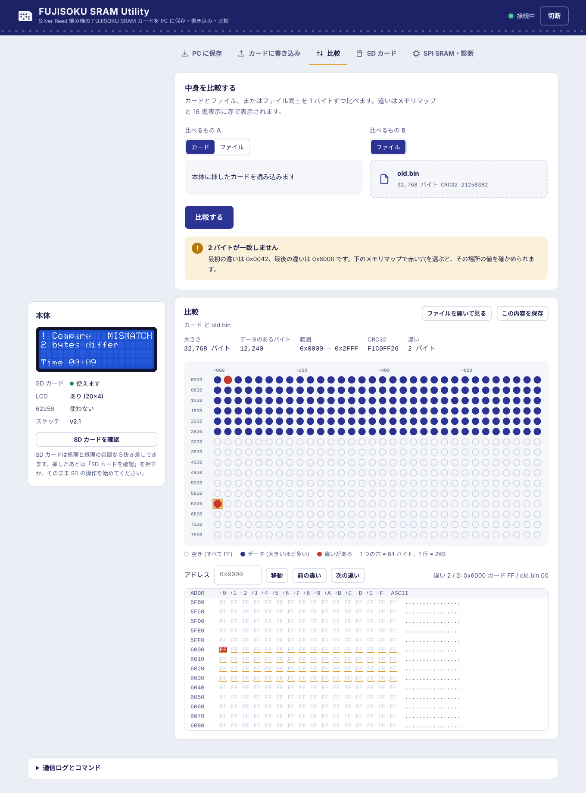

# Web アプリの使い方

`webapp/FSRAM-Utility.html` は 1 ファイルだけの Web アプリです。インストールやサーバーは要りません。ファイルをダブルクリックして開くか、GitHub Pages などに置いて開きます。

## 1. 必要なもの

- PC の **Google Chrome** または **Microsoft Edge**（Web Serial に対応したブラウザ）。Safari、Firefox、スマートフォンでは本体に接続できません（ファイル同士の比較と中身の表示はできます）。
- スケッチ v2 を書き込んだ本体と USB ケーブル。
- Arduino IDE のシリアルモニタなど、同じシリアルポートを使うアプリは閉じておく。

## 2. 接続

1. 右上の「本体に接続」を押し、一覧から本体のシリアルポート（UNO R4 なら「USB シリアルデバイス」や「Arduino UNO R4」）を選ぶ。
2. 接続できると「接続中」になり、左の「本体」に **本体の表示（LCD と同じ画面）**、カードの有無と電池電圧、SD カード・LCD・SPI SRAM の状態、スケッチのバージョンが出ます。LCD が無い本体でも、表示はここに出ます（「LCD: なし (表示はここだけ)」）。
3. 「本体がこのアプリに応答しません」と出たら、スケッチ v2 が書き込まれているか、ほかのアプリがポートを使っていないかを確かめてください。

### 2.1 カードと電池

| 表示 | 内容 |
|---|---|
| カード | 「入っています」/「入っていません」。抜き差しするとすぐ変わる。カードが入っていないときにカードを使う操作をすると「カードが入っていません」と出る（処理の途中で抜いた場合も同じ） |
| 電池 | カードの電池電圧（例 `2.75 V`）。**1.70 V 以下**になると「(少ない)」と出し、画面の上に「カードの電池が少なくなっています」の警告を出す。**0.50 V 以下**は「なし」と出し、「カードに電池が入っていません」の警告を出す（本体に挿しているあいだは中身が保たれるが、抜くと消える）。どちらも「PC に保存」で保存してから電池を入れる・交換する |

カードの検出・電池電圧を使わない本体では「検出しない」「測らない」と出ます。

## 3. タブ

### PC に保存

「読み込んで保存」を押すと、保存先を選んでからカードを読み込みます（保存先を選べないブラウザではダウンロードになります）。

- 「読み込む大きさ」: **32KB（既定）**・64KB・128KB・256KB・512KB・1MB のボタンで選びます。ふつうのカードは 32KB です。32KB 以外で保存したファイルの名前には `_64KB` のように大きさが付きます。
  - 32KB のカードを大きく読むと、上位のアドレス線がつながっていないので同じ内容がくり返し読めます。そのときは結果に「後半は先頭 32KB と同じ内容のくり返しです」と出ます（カードの容量の目安になります）。
  - 本体のスケッチが読める大きさ（`hello` の `cardmax`）より大きいボタンは押せません。v2.3 までは 32KB、v2.4〜v2.8 は 256KB、v3.0 から 1MB です。
  - 読み込みの時間は大きさに比例します（1MB は 32KB の 32 倍）。
- 「2 回読み込んで一致を確かめる」（既定でオン）: 接触不良による読み違いに気づけます。2 回の結果が違うときは保存せず、違う場所を下のメモリマップに赤で表示します。

### カードに書き込み

1. `.bin`（32,768〜1,048,576 バイト = 32KB〜1MB）をドロップするか、クリックして選ぶ。それ以外の大きさのファイルは選べません。
2. 「書き込む大きさ」を選ぶ（**32KB・64KB・128KB・256KB・512KB・1MB**）。ファイルを選ぶと、ファイルの大きさのボタンが選ばれます。ファイルの先頭から、選んだ大きさだけを書きます（例: 1MB のファイルで 256KB を選ぶと先頭 256KB だけ。カードの 0x40000 以降は変えない）。
   - ファイルより大きいボタンと、本体のスケッチが扱えない大きさ（`hello` の `cardmax` より大きい）のボタンは押せません。v2.3 までは 32KB、v2.4〜v2.8 は 256KB、v3.0 は 1MB までです。
   - 32KB・64KB… のどれでもない大きさのファイル（例: 40,000 バイト）では「全体 (40,000 バイト)」のボタンが出て、既定で選ばれます。
3. 「カードに書き込む」→ 確認ダイアログで「書き込む」。

**32KB より大きく書く**とき（書き込む大きさが 64KB 以上）は、確認ダイアログが警告「32KB より大きいファイルです」に変わり、どこまで書くかを選びます。

| ボタン | 動き |
|---|---|
| 先頭 32KB だけ書き込む | ファイルの先頭 32,768 バイトだけを書く。カードの 0x8000 以降は変えない |
| すべて書き込む（256KB など） | 「書き込む大きさ」で選んだ大きさを書く。カードの容量がその大きさ以上あるときだけ選ぶ |
| やめる | 何もしない |

ふつうのカード（32KB）は上位のアドレス線がつながっていないので、32KB を超えて書くと 0x8000 以降のデータが先頭から上書きされます。カードの容量が書き込む大きさ以上あるときだけ大きく書いてください。容量が足りないと照合で違いが見つかり、「カードの容量が書き込んだ大きさより小さく、先頭が上書きされた可能性もあります」と出ます。

- 「書き込む前に、今のカードの内容を PC に保存する」（既定でオン）: 書き込む大きさだけ読んで `backup_日付_時刻.bin` としてダウンロードされます。読み込んだ内容と比べて、**変わった 64 バイト単位の部分だけ**を書き込むので速くなります。
- 「書き込んだあと読み戻して照合する」（既定でオン）: 違いがあれば、その場所を表示します。

### 比較

- 「比べるもの A」でカードかファイルを選び、「比べるもの B」にファイルを選んで「比較する」。
- 結果は「すべて一致しました」か、違うバイト数と最初・最後のアドレス。違いはメモリマップの赤い穴と、16 進表示の赤い文字で確かめられます。
- カードと比べるときは、ファイル B と同じ大きさだけカードを読みます（32KB〜1MB）。
- ファイル同士の大きさが違うときは、短いほうの長さまで比べ、大きさが違うことを結果に出します。
- ファイル同士の比較は本体なしでもできます。

### SD カード

本体の SD カードとの間で、PC を通さずに保存・照合・書き込みをします。本体が SD カードを使わない設定（`USE_SD` = 0、既定）のときは、このタブは表示されず、左の「SD カード」は「使わない」になります。

- ファイル名は英数字と `_` `-` の 16 文字まで（`.bin` は自動で付く）。「一覧を更新」で SD の `.bin` を表示し、行を押すとファイル名に入ります。
- 「SD → カードに書き込む」は確認のあと、書き込みと照合まで行います。
- SD カードは処理の合間なら抜き差しできます。抜くと左の表示が「入っていません」になり、挿したあとは「SD カードを確認」を押すか、そのまま操作を始めれば認識します。処理の途中で抜いた場合も、保存中だったなら前のファイルは残っています。

### SPI SRAM・診断

本体の SPI SRAM との間のコピー・比較・消去と、SPI SRAM の自己診断、カードの消去です。SPI SRAM はオプションなので、本体の設定に合わせて表示が変わります（左の「本体」の欄にも SPI SRAM の状態が出ます）。

| 本体の SPI SRAM | 表示 |
|---|---|
| 使えます | すべての操作 |
| 見つかりません（`USE_SPI_SRAM` は 1） | 案内と「SPI SRAM の自己診断」とカードの消去だけ。配線を直して自己診断を実行すると探し直し、見つかればほかの操作も出ます |
| 使わない（`USE_SPI_SRAM` = 0） | SPI SRAM の操作は出さず、タブの名前は「消去・診断」 |

自己診断は SPI SRAM（/CS = D6）のモードレジスタと読み書きを確かめ、異常があれば「応答なし（/CS・MISO・電源を確認）」か「値が違う（MOSI・SCK・チップを確認）」かを表示します。カードを書き換える操作には確認が出ます。

62256（動作確認用の SRAM）の操作は v3.0 で無くなりました（ハードウェアの §9.2）。

### ファイルの選び直し

「カードに書き込み」と「比較」のファイル欄は、ファイルを選んだあとも、クリックかドロップで別のファイルに替えられます。同じ名前のファイルを選び直すこともできます（ファイルを作り直したときなど）。欄の右の「×」で、選んだファイルを外せます（処理中は押せません）。

## 4. 中身の表示

カードを読み込んだときや、ファイルを選んだとき、比較したときに、下の「中身の表示」に出ます。「ファイルを開いて見る」で、手元の `.bin` を開いて見ることもできます。

- **メモリマップ**: 32 列 × 16 行（512 個）の穴で表します。1 つの穴は 32KB なら 64 バイト（1 行 = 2KB）、64KB なら 128 バイト、128KB なら 256 バイト、256KB なら 512 バイト、512KB なら 1KB、1MB なら 2KB です（凡例に出ます）。白抜きはすべて `FF`（空き）、塗りつぶしはデータ（大きいほど `FF` 以外が多い）、赤は違いがある場所です。穴にマウスを載せるとアドレスと内訳が、押すとその場所の 16 進表示が出ます。
- **16 進表示**: アドレスを入れて「移動」、比較の結果があれば「前の違い」「次の違い」で違いを順に見られます。違うバイトにマウスを載せると、相手側の値が出ます。
- 「この内容を保存」で、表示中の内容を `.bin` として保存できます。

## 5. 中断と接続の切断

- 処理中は上に進捗（%、バイト数、経過時間、残り時間の目安）が出ます。% と残り時間は作業全体（書き込み + 照合、1 回目 + 2 回目の読み込みなど）、バイト数は今の段階の中の数です（32KB の書き込みなら「書き込み … / 32,768」「照合 … / 32,768」。足した 65,536 は出しません）。本体の LCD も段階ごとに 0 から進みます。「中断」でいつでも止められます。
- 処理中に USB が抜けると「本体との接続が切れました」と出ます。本体は 8 秒後に LCD に「PC LOST」を出して待機に戻ります。カードへの書き込み中だった場合は、書き込む前に保存したファイルから書き直せます。

## 6. 通信ログとコマンド

画面下の「通信ログとコマンド」を開くと、本体とのやりとりが見られます。コマンドを直接送ることもできます（[protocol.md](protocol.md)）。「データ行も表示する」をオンにすると、読み出しデータや進捗の行も表示します。
