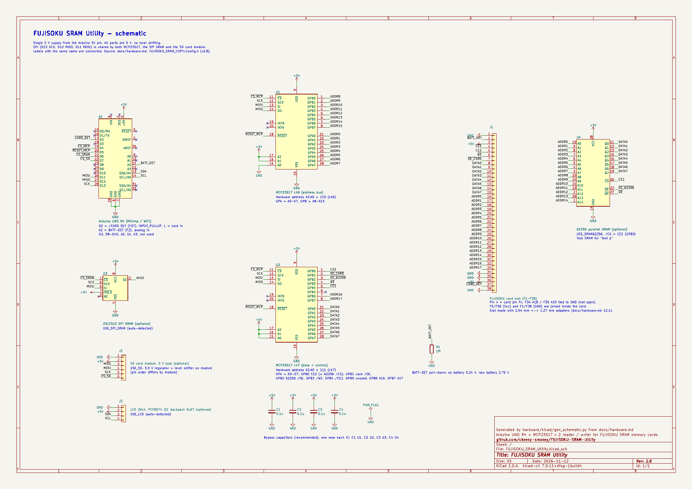
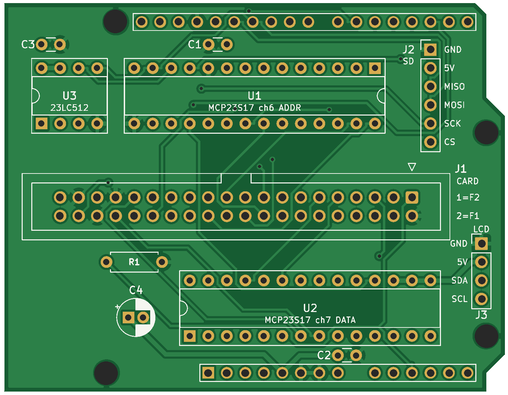
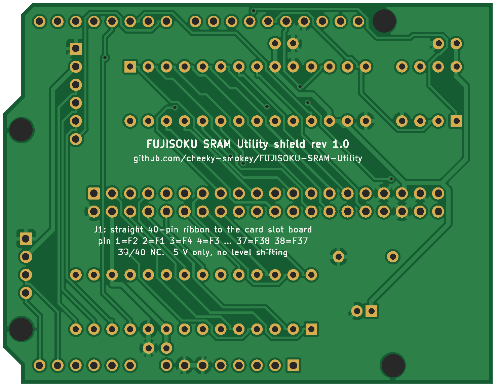

# 回路図・シールド基板（KiCad）

FUJISOKU SRAM Utility の回路図と、Arduino UNO R4 用のシールド基板です。[docs/hardware.md](../../docs/hardware.md) の結線表と `FUJISOKU_SRAM_COPY/config.h` のピン定義（v2.8）から作りました。

- [回路図](#回路図)（スロット・62256 も含む全体）
- [シールド基板](#シールド基板arduino-uno-r4-用)（ガーバー付き。カードとはリボンケーブルでつなぐ）

## 回路図



| ファイル | 内容 |
|---|---|
| `FUJISOKU_SRAM_Utility.kicad_pro` / `.kicad_sch` | KiCad のプロジェクトと回路図（KiCad 7 で作成。8 / 9 でも開ける） |
| `FUJISOKU_SRAM_Utility.pdf` | 印刷・閲覧用の PDF（A3） |
| `gen_schematic.py` | 回路図を作るスクリプト。結線を変えるときはここを直して作り直す（`--shield` でシールド基板用の回路図） |
| `check_netlist.py` | 回路図の結線が仕様書どおりかを確かめるスクリプト（`--shield` でシールド基板用） |

### 載っている部品

| 部品番号 | 部品 | 備考 |
|---|---|---|
| A1 | Arduino UNO R4 | KiCad の UNO R3 の形（ピン配置は同じ） |
| U1 | MCP23S17 ch6 | アドレス A0〜A15。A2:A0 = 110 |
| U2 | MCP23S17 ch7 | データ D0〜D7、制御線、A16/A17。A2:A0 = 111 |
| J1 | FUJISOKU カードのスロット（F1〜F38） | ピン番号 n = カードのピン Fn。F34（A18）・F35（A19）は GND |
| R1 | 1 MΩ | BATT-DET（A2）のプルダウン |
| U3 | 23LC512（オプション） | SPI SRAM、/CS = D6 |
| U4 | 62256（オプション） | 動作確認用の SRAM、/CS = CE2（GPB0） |
| J2 | SD カードモジュール（オプション） | 5 V 用。/CS = D7。ピンの並びはモジュールによって違う |
| J3 | 20×4 LCD + PCF8574（オプション） | I2C、アドレス 0x27 |
| C1〜C4 | 0.1 µF | 各 IC の近くに置くパスコン（推奨。仕様書には無い部品） |

- 部品どうしは、ピンに付けた名前（ネットラベル）でつないでいます。同じ名前のラベルがつながっています。
- 電源は Arduino の 5V ピンから取る 5 V だけです。部品はすべて 5 V 系で、レベル変換はありません。

## シールド基板（Arduino UNO R4 用）

| 表 | 裏（裏から見た向き） |
|---|---|
|  |  |

- 大きさは Arduino UNO と同じ（68.6 × 53.3 mm）。2 層、厚さ 1.6 mm。UNO R4 Minima / WiFi に重ねて使います。
- 部品はすべてスルーホールで、IC は DIP（ソケット）です。62256 は載せていません。
- カードは **J1（40 ピンのボックスヘッダ）から、ストレートの 40 芯リボンケーブル**（両端 IDC ソケット、1 番どうしがつながるもの）でスロット基板の 40 ピンヘッダにつなぎます。
  ヘッダのピンとカードのピンの対応はスロット基板と同じです。

  | J1 のピン | 1 | 2 | 3 | 4 | 5 | 6 | … | 37 | 38 | 39 | 40 |
  |---|---|---|---|---|---|---|---|---|---|---|---|
  | カード | F2 | F1 | F4 | F3 | F6 | F5 | … | F38 | F37 | 空き | 空き |

  （2k−1 番 = F2k、2k 番 = F2k−1）。F34（A18、33 番）と F35（A19、36 番）は基板上で GND につないでいます（開放は不可）。
- 配線は自動配線（Freerouting）で、表と裏に GND のベタを敷いています。ビアは 10 個です。
- 確認済み: DRC（設計ルールの確認）でエラーと未配線は 0、基板の銅のつながりを `check_netlist.py --shield` で仕様書の結線表と照合。

### ファイル（`shield/`）

| ファイル | 内容 |
|---|---|
| `gerber/FSU_Shield_gerber.zip` | **基板メーカーに出すデータ**（ガーバーとドリル） |
| `FSU_Shield.kicad_pro` / `.kicad_pcb` / `.kicad_sch` | KiCad のプロジェクト、基板、回路図 |
| `FSU.pretty/`、`fp-lib-table` | シールド用の Arduino のフットプリント（下の注意を参照） |
| `FSU_Shield_top.png` / `_bottom.png` | 基板の見た目（確認用） |
| `FSU_Shield_1to1.pdf` | 原寸の図（A4 に 100 % で印刷して Arduino を重ね、ピンの位置を確かめる用） |
| `drc_report.txt` | DRC の結果 |
| `../gen_pcb.py` | 基板を作るスクリプト（配置、自動配線、ベタ、DRC、ガーバー） |

### 部品表

| 部品番号 | 部品 | 個数 | 備考 |
|---|---|---|---|
| U1, U2 | MCP23S17-E/SP（DIP-28、幅 7.62 mm） | 2 | 28 ピン IC ソケット（300 mil）を使う |
| U3 | 23LC512-I/P（DIP-8） | 1 | オプション。8 ピン IC ソケット。挿さなくても動く（自動検出） |
| J1 | 40 ピン（2×20）ボックスヘッダ、2.54 mm、ストレート | 1 | 切り欠きは基板の内側（U1 側） |
| J2 | ピンヘッダ 1×6 | 1 | SD カードモジュール（オプション）。ジャンパ線でつなぐ |
| J3 | ピンヘッダ 1×4 | 1 | LCD（オプション）。GND、5V、SDA、SCL |
| R1 | 1 MΩ 1/4 W | 1 | BATT-DET（A2）のプルダウン |
| C1〜C3 | 0.1 µF 積層セラミック、足の間隔 2.5 mm | 3 | U1〜U3 のパスコン |
| C4 | 10 µF 電解（16 V 以上、直径 5 mm、足の間隔 2 mm） | 1 | カードの電源用。+ の向きに注意 |
| — | ピンヘッダ（オス）1×10、1×8、1×8、1×6 | 各 1 | Arduino に挿す側。普通のシールドと同じく裏から差して表ではんだ付け |
| — | 40 芯リボンケーブル（両端 IDC ソケット） | 1 | スロット基板との接続 |

### 注文のしかた

1. `shield/gerber/FSU_Shield_gerber.zip` を、そのまま JLCPCB、PCBWay、Elecrow などにアップロードします。
2. 設定は標準のままで作れます: 2 層、1.6 mm、線幅 0.3 mm 以上（電源 0.6 mm）、間隔 0.25 mm 以上、ビア 0.8 mm（穴 0.4 mm）。
3. 注文の前に、`FSU_Shield_1to1.pdf` を A4 に **100 %（拡大縮小なし）** で印刷し、Arduino を重ねてピンの位置を確かめると確実です。

### 組み立て・使うときの注意

- **IC の向きに注意**: U1 は U2・U3 と逆向きです（U1 は切り欠きが右、1 番ピンが右上。U2・U3 は切り欠きが左、1 番ピンが左下）。シルクの切り欠きと四角いパッド（1 番ピン）に合わせて挿します。
- J1 は 1 番ピン（▽ の印、四角いパッド）が右端です。リボンケーブルの赤い線が 1 番です。
- **DC ジャック（左下）と ICSP ヘッダ（右の中ほど）の上には、部品の足が出ないように**配置してあります。USB-C の上（左上）には U3 があります（UNO R4 の USB-C は背が低いので当たりません）。
- MCP23S17 のアドレス（A2:A0）は基板の配線で決めてあります（U1 = 110、U2 = 111）。設定は要りません。
- J2（SD）は、モジュールによってピンの並びが違うので、シルクの名前（GND、5V、MISO、MOSI、SCK、CS）を見てジャンパ線でつなぎます。5 V で使えるモジュールを使います。
- 62256（`USE_SRAM62256`）は載せていません。U2 の GPB2（62256 の /OE）は未接続です。

### KiCad の標準の Arduino のフットプリントについて

KiCad 標準の `Module:Arduino_UNO_R3` は、上から見るとデジタル側のヘッダが下に来る向き（Arduino を裏返して載せる向き）で描かれています。シールドにそのまま使うと鏡に映した形になり、Arduino に挿せません。この基板では、それを上下反転した `FSU:Arduino_UNO_R4_Shield`（`shield/FSU.pretty`、原点は Arduino の基板の左下）を使っています。パッド番号は標準と同じなので、シンボル `MCU_Module:Arduino_UNO_R3` とそのまま対応します。

## 作り直す・確かめる

KiCad 7 以降が入った PC で次を実行します。

```sh
python3 gen_schematic.py                       # 回路図を作り直す (KiCad の標準シンボルライブラリを使う)
kicad-cli sch export pdf -o FUJISOKU_SRAM_Utility.pdf FUJISOKU_SRAM_Utility.kicad_sch
kicad-cli sch export netlist --format kicadsexpr -o /tmp/fsu.net FUJISOKU_SRAM_Utility.kicad_sch
python3 check_netlist.py /tmp/fsu.net          # 結線を確かめる (OK と出れば仕様書どおり)
```

`check_netlist.py` は、カードのピン・MCP23S17・Arduino・SPI の各部品・62256 のつながりと、+5V・GND、GND に固定するカードの F34（A18）・F35（A19）、未接続のピン（MCP の INT、ch7 GPB5 など）を、仕様書の表と照らし合わせます。

シールド基板は次のとおりです。`gen_pcb.py` には KiCad の標準フットプリント（`kicad-footprints`）、Java と [Freerouting](https://github.com/freerouting/freerouting) 1.9 が要ります（`FREEROUTING_JAR` で jar の場所を指定。画面の無い環境では `xvfb-run` を使う）。

```sh
python3 gen_schematic.py --shield              # shield/FSU_Shield.kicad_sch
python3 gen_pcb.py                             # 基板、DRC、仕様書との照合、ガーバー、画像
```

自動配線は実行のたびに少し違う結果になります（全部つながるまで自動でやり直します）。
